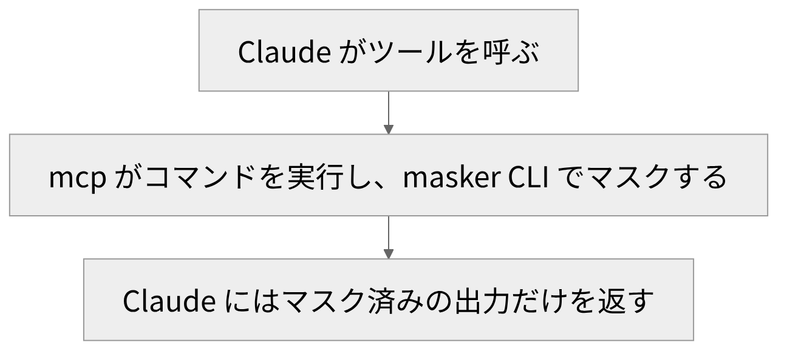

# SensitiveMasker

<!-- さて、今日は自作のツールの話です。 -->
<!-- 名前は、センシティブマスカーといいます。 -->
<!-- これは、AIに貼る前に、値を隠すためのツールです。 -->
<!-- なお、デモはせず、スライドの例で説明します。 -->
<!-- ここで見せる値は、全部、架空のものです。 -->
<!-- 話は、三つあります。 -->
<!-- 一つ目は、困りごとです。 -->
<!-- 二つ目は、Windows向けに作ったものです。 -->
<!-- 三つ目は、次期版の構成です。 -->
<!-- 次期版は、公開済みの初期バージョンの話です。 -->
<!-- 最後に、このツールの限界も話します。 -->

---

<!-- header: "" -->
<!-- footer: "" -->

# AIに貼る前に隠したい

<!-- さて、最初は、ログやコマンドの出力をAIに貼る前に隠したい値の話です。 -->

---

<!-- header: AIに貼る前に隠したい -->
<!-- footer: https://genai.owasp.org/llmrisk/llm022025-sensitive-information-disclosure/<br>https://genai.owasp.org/llm-top-10/<br>https://www.rfc-editor.org/rfc/rfc5737 -->

ログやコマンドの出力を外部のAIに貼る前に、値を隠したい

| 隠したいもの | 例(架空の値) |
|---|---|
| 電話番号 | 03-0000-0000 |
| SIPの認証情報 | sip-user-0001 / dummy-secret |
| IPアドレス | 203.0.113.10(文書用の予約アドレス) |

OWASP LLM02:2025の対策の1つ: 機密情報の入力を避ける指針を、利用者に示す

<!-- で、ログやコマンドの出力を、外部のAIに貼って相談したい場面があります。 -->
<!-- しかし、そのまま貼ると、隠したい値も一緒に渡ります。 -->
<!-- ここが困りごとです。 -->
<!-- その値は、電話番号とSIPの認証情報とIPアドレスです。 -->
<!-- なお、表の値は全部、架空のものです。 -->
<!-- また、IPアドレスは、文書用に予約された範囲です。 -->
<!-- ここで、言葉を決めます。 -->
<!-- マスク、つまり値を記号に置き換えることです。 -->
<!-- 目標は、AIに渡る文字列を、置き換え後のものだけにすることです。 -->
<!-- さて、セキュリティ団体OWASPの資料にも、似た話があります。 -->
<!-- それは、生成AIのリスク一覧にある、機密情報の漏えいです。 -->
<!-- 意図せず機密情報を入れるリスクも、含まれます。 -->
<!-- その対策の一つに、入力を避ける指針を、利用者に示すことが挙がっています。 -->
<!-- そこで作ったのが、貼る前に隠す道具です。 -->

---

<!-- header: "" -->
<!-- footer: "" -->

# 作ったもの(Windows版)

<!-- そこで次は、その困りごとのために作った、Windows版の話です。 -->

---

<!-- header: 作ったもの(Windows版) -->
<!-- footer: https://github.com/akutori/SensitiveMaskerWin<br>https://github.com/akutori/SensitiveMaskerWin/blob/main/README.md<br>https://github.com/akutori/SensitiveMaskerWin/blob/main/src/gui/settings.py<br>https://docs.python.org/3/library/tkinter.html -->

個人用のデスクトップツール。PythonとtkinterでGUIを作り、GitHubで公開している
マスク処理はローカルで実行する。ルールのテンプレートは汎用とSIPの2種類

```bash
# READMEのCLI実行例
uv run python -m cli.main --profile my_profile.json --input in.log --output out.log
```

```text
# 前(架空データ)
caller=03-0000-0000 peer=203.0.113.10 password=dummy-secret
caller=06-0000-0000 peer=203.0.113.10 password=dummy-secret
# 後(汎用テンプレートの実行結果)
caller=__MASK_PHONE_1__ peer=__MASK_IP_1__ password=__MASK_REDACTED__
caller=__MASK_PHONE_2__ peer=__MASK_IP_1__ password=__MASK_REDACTED__
```

<!-- 実は、これは個人用のデスクトップツールです。 -->
<!-- そして、画面は、tkinterで作りました。 -->
<!-- つまり、Pythonの標準の画面部品です。 -->
<!-- また、GitHubで公開もしています。 -->
<!-- さらに、画面とCLIは、同じマスク処理を使います。 -->
<!-- その処理は、手元のパソコンの中で終わります。 -->
<!-- なお、CLIは、コマンドラインのことです。 -->
<!-- また、ルールのテンプレートは、汎用とSIPの二つです。 -->
<!-- 次に、スライドのコマンドを見てください。 -->
<!-- その下が、前と後の例です。 -->
<!-- 前の値は全部架空で、後の行は実際の実行結果です。 -->
<!-- つまり、三つの値が、記号に変わります。 -->
<!-- 置き換え方には、固定の値と、連番があります。 -->
<!-- ここがポイントです。 -->
<!-- 同じ値は、同じ記号になります。 -->
<!-- 違う電話番号は、番号が一つ進みます。 -->
<!-- そのため、どの行が同じ値かは、記号を見れば分かります。 -->

---

<!-- header: 作ったもの(Windows版) -->
<!-- footer: https://github.com/akutori/SensitiveMaskerWin/blob/main/src/masking_core/profile_io.py<br>https://github.com/akutori/SensitiveMaskerWin/blob/main/src/masking_core/models.py<br>https://github.com/akutori/SensitiveMaskerWin/blob/main/src/gui/settings.py<br>https://github.com/akutori/SensitiveMaskerWin/blob/main/README.md<br>https://github.com/akutori/SensitiveMasker -->

**いまの課題と限界(例は汎用テンプレートの場合)**

- ルールプロファイルのJSONは暗号化せず保存(次期版では暗号化して保存)
- ルールは固定文字列か正規表現で書き、合う値だけを隠す
- 取りこぼし(隠すべき値が残る): ハイフンなしの電話番号、IPv6アドレス
- 過剰マスク(不要な値まで隠れる): 1.2.3.4 形式のバージョン番号
- ストリーミング処理では、行をまたぐルールが効かない場合がある

【差し込み: 実際の画面と、使っている頻度・場面】

<!-- さて、次は、いまの課題の話です。 -->
<!-- 一つ目は、保存の仕方です。 -->
<!-- まず、ルールプロファイル、つまり隠すルールの設定ファイルです。 -->
<!-- これを、暗号化せずに、そのままJSONで保存しています。 -->
<!-- 次期版では、暗号化して保存しています。 -->
<!-- 二つ目は、マスクの限界です。 -->
<!-- ルールは、固定の文字列か、正規表現で書きます。 -->
<!-- 正規表現、つまり文字の並びの形を書く方法です。 -->
<!-- そのため、ルールに合わない値は、残ります。 -->
<!-- これが、取りこぼしです。 -->
<!-- たとえば、ハイフンのない電話番号です。 -->
<!-- 反対に、IPアドレスのルールは、四つの数字が並ぶバージョン番号にも合います。 -->
<!-- これが、過剰マスクです。 -->
<!-- ここが限界です。 -->
<!-- つまり、どちらも完全には防げません。 -->
<!-- また、一行ずつの処理では、行をまたぐルールが効かないことがあります。 -->
<!-- (※ここで実体験を話す: 実際の画面を見せながら、使っている頻度と場面について) -->
<!-- 以上が現状です。 -->

---

<!-- header: "" -->
<!-- footer: "" -->

# 次期版(Tauri版)

<!-- さて、ここからは、公開済みの次期版について話します。 -->

---

<!-- header: 次期版(Tauri版) -->
<!-- footer: https://v2.tauri.app/start/<br>https://github.com/clap-rs/clap<br>https://github.com/modelcontextprotocol/rust-sdk<br>https://www.sqlite.org/about.html<br>https://github.com/akutori/SensitiveMasker -->

共有コア masking-core と、3つの殻(gui / cli / mcp)に分けた構成

| 殻 | 技術 | 特徴 |
|---|---|---|
| `gui` | Tauri(Rust + React) | プロファイルをSQLiteで管理し、一覧から選ぶ<br>常駐(トレイ)動作 |
| `cli` | clap | 未初期化なら止まる。`masker init` が必須 |
| `mcp` | rmcp(公式SDK) | AIから呼び出す入口(マスクはCLIに任せる) |

公開リポジトリの v0.0.6 の構成(2026年10月時点)

<!-- まず、全体の構成です。 -->
<!-- ここで、マスクの本体は、共有コアにまとめています。 -->
<!-- そして、外側に、殻を三つ付けています。 -->
<!-- それは、画面とCLIと、AI向けの入口です。 -->
<!-- 実は、Windows版にも、画面とCLIがあります。 -->
<!-- まず、画面は、Tauriで作っています。 -->
<!-- つまり、Webの技術で作る、アプリの枠組みです。 -->
<!-- 次に、CLIは、clapです。 -->
<!-- つまり、RustでCLIの引数を読む部品です。 -->
<!-- 最後に、AI向けの入口は、rmcpです。 -->
<!-- これは、MCPの公式SDKです。 -->
<!-- つまり、MCPは、AIと外のシステムをつなぐ共通の規格です。 -->
<!-- そして、プロファイルは一覧から選べます。 -->
<!-- 保存先は、SQLite、つまりファイル一つのデータベースです。 -->
<!-- そして、CLIは、初期化するまで止まります。 -->
<!-- 安全な側に倒す設計です。 -->
<!-- ここまでが、全体の構成です。 -->

---

<!-- header: 次期版(Tauri版) -->
<!-- footer: https://modelcontextprotocol.io/docs/getting-started/intro<br>https://modelcontextprotocol.io/specification/2026-07-28/server/tools<br>https://github.com/FiloSottile/age<br>https://github.com/akutori/SensitiveMasker/tree/v0.0.6/crates -->



- ツール: `run_masked_command(command, timeout_seconds?, profile?, encoding?)`
- 対象の例: terraform、asterisk -rx、fs_cli、tail -f(標準出力のみ)
- 設定は暗号化し、鍵は別ファイルに分けてOSのファイル権限で守る
- 別PCへの移行は、パスフレーズで再暗号化する(`age -p` 相当)

<!-- 次は、AIとつなぐ部分です。 -->
<!-- ここで使うのが、さきほどのMCPです。 -->
<!-- そして、ツール、つまりAIが呼べる機能は一つだけです。 -->
<!-- 名前と引数は、スライドを見てください。 -->
<!-- 制限時間と、使うルールと、文字コードも、指定できます。 -->
<!-- 中身は、コマンドを実行して、出力をCLIでマスクして返すことです。 -->
<!-- つまり、AIには、マスクした出力だけが届きます。 -->
<!-- ここがポイントです。 -->
<!-- 対象は、スライドに並べた、コマンドの標準出力です。 -->
<!-- エラーの出力は、対象外です。 -->
<!-- なお、MCPの仕様は、人が実行を止められる形を勧めています。 -->
<!-- 次に、設定の守り方です。 -->
<!-- 設定は、暗号化して保存します。 -->
<!-- そして、鍵は別のファイルに分けます。 -->
<!-- そのファイルは、OSのファイル権限で守ります。 -->
<!-- 最後に、別のパソコンへの移行です。 -->
<!-- そのときは、パスフレーズで暗号化し直します。 -->
<!-- ここまでが、設定の守り方です。 -->

---

<!-- header: "" -->
<!-- footer: "" -->

# まとめ

- 電話番号・SIPの認証情報・IPアドレスをAIに貼る前に隠す、Windows版を作った
- Windows版はGitHubで公開済みで、JSONは暗号化せずに保存している
- 次期版(Tauri版)は v0.0.6 まで公開済みで、共有コアと3つの殻に分けている
- MCPのツールを通して、AIにはマスク済みの標準出力だけを渡せる
- マスクはルールに合う値だけを置き換えるため、取りこぼしと過剰マスクが残る<br>貼る前に、マスク結果を人が確認する必要がある

<!-- さて、最後にまとめます。 -->
<!-- 困りごとは、AIに貼る前に、隠したい値を隠すことでした。 -->
<!-- つまり、隠す対象は、電話番号とSIPの認証情報とIPアドレスです。 -->
<!-- そのために、Windows版を作って、GitHubで公開しています。 -->
<!-- しかし、設定のJSONは、暗号化せずに保存しています。 -->
<!-- 次期版も、初期のバージョンを公開しています。 -->
<!-- 共有コアと、三つの殻に分けています。 -->
<!-- そして、MCPを通すと、AIにはマスクした出力が渡ります。 -->
<!-- ここからは、注意です。 -->
<!-- ルールは、固定の文字列か、正規表現で書きます。 -->
<!-- そして、ルールに合う値だけを、置き換えます。 -->
<!-- そのため、マスクは、完全ではありません。 -->
<!-- つまり、取りこぼしも、過剰マスクも残ります。 -->
<!-- そこで、貼る前に、マスク結果を人が確認する必要があります。 -->
