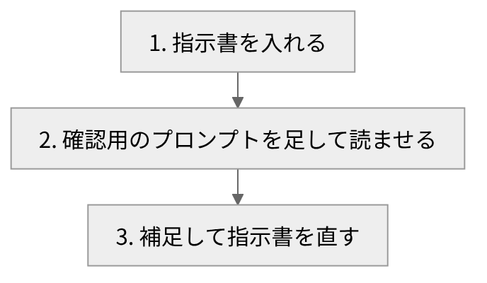

# 悲観的開発手法

<!-- さて、悲観的開発手法の話をします。 -->
<!-- 悲観的という名前ですが、暗い話ではありません。 -->
<!-- で、今日は二つ話します。 -->
<!-- 一つ目は、この手法の全体像です。 -->
<!-- 二つ目は、ある記事で知った技法の紹介です。 -->
<!-- 最後まで、よろしくお願いします。 -->

---

<!-- header: "" -->
<!-- footer: "" -->

# 悲観的開発手法とは

<!-- さて、まずは悲観的開発手法とは何なのかを、前提から順に説明していきます。 -->

---

<!-- header: 悲観的開発手法とは -->
<!-- footer: https://www.informit.com/store/working-effectively-with-legacy-code-9780132931779 -->

- 対象: テスト基盤・デバッガ・チーム文化がない現場
- レガシーの定義の一つ(Feathers): 変更しやすい・変更後にすぐ確認できる・理解できている、のどれかが欠けたコード
- 問い: その現場で、品質をどう守るか
- 悲観的: **最悪を先に想定して備える姿勢**(この手法での定義)

<!-- で、最初に前提を決めます。 -->
<!-- 対象は、こんな現場です。 -->
<!-- まず、テスト基盤がありません。 -->
<!-- 次に、デバッガもありません。 -->
<!-- そして、チーム文化もありません。 -->
<!-- これらは、品質を守る仕組みです。 -->
<!-- ここで、レガシーの話です。 -->
<!-- つまり、手を入れにくいコードのことです。 -->
<!-- 定義の一つに、三つの問いがあります。 -->
<!-- 変更しやすいか。 -->
<!-- 変更後に、すぐ確認できるか。 -->
<!-- 理解できているか。 -->
<!-- 三つのうち一つでも、いいえならレガシーです。 -->
<!-- これは、洋書にある定義です。 -->
<!-- 出典は、画面の下に載せています。 -->
<!-- そんな現場で、品質をどう守るか。 -->
<!-- これが出発点です。 -->
<!-- で、ここでの悲観的とは、最悪を先に想定して備える姿勢のことです。 -->
<!-- これは、自分なりの定義です。 -->
<!-- 暗い意味ではないんです。 -->

---

<!-- footer: https://www.informit.com/store/test-driven-development-by-example-9780321146533 -->

4本の柱をまとめる総称が、悲観的開発手法

1. 悲観的設計
2. 悲観的TDD(最初の名前)
3. 悲観的チーム実践(実践の方法を作成済み)
4. 悲観的メンタリング(カリキュラムを作成済み)

TDD: 失敗する自動テストを先に書いてから実装する開発(Beck)

<!-- さて、全体は四つの柱でできています。 -->
<!-- 設計と、TDDです。 -->
<!-- それから、チーム実践と、メンタリングです。 -->
<!-- 四つとも、頭に悲観的が付きます。 -->
<!-- この四本をまとめた総称が、悲観的開発手法です。 -->
<!-- 実は、最初の名前は悲観的TDDでした。 -->
<!-- ここでTDDとは、テストを先に書く開発のことです。 -->
<!-- まず、小さなテストを書いて、失敗させます。 -->
<!-- 次に、そのテストを通します。 -->
<!-- 最後に、重複を取り除きます。 -->
<!-- 出典は、画面の下に載せています。 -->
<!-- 悲観的TDDは、今は柱の一本です。 -->
<!-- で、チーム実践は、やり方をまとめました。 -->
<!-- あと、メンタリングもあります。 -->
<!-- こちらは、カリキュラムを作りました。 -->
<!-- つまり、TDDだけの話ではありません。 -->
<!-- 設計から、チームと育成までを扱います。 -->
<!-- ここまでが、柱の話です。 -->

---

<!-- footer: https://platform.claude.com/docs/en/about-claude/glossary -->

13章の文書にまとめている(主な内容)

- 3つの基本原則
  - 【差し込み: 原則の名前と1行説明を3つ】
- 6つの技法カテゴリ
- レガシー度合いのスペクトラム
- LLMの活用(「AI仮実行」という技法を含む)
- 心理面の枠組み

<!-- ここから、中身を少し見ます。 -->
<!-- 全体は、十三章の文書にまとめています。 -->
<!-- まず、基本原則があります。 -->
<!-- (※ここで実体験を話す: 3つの基本原則について、名前と一言ずつ) -->
<!-- 次に、技法があります。 -->
<!-- 六つのカテゴリに分かれています。 -->
<!-- 中身は、今日は省きます。 -->
<!-- ほかに、レガシー度合いのスペクトラム、つまり度合いの幅の話があります。 -->
<!-- そして、LLM、つまり大規模言語モデルの活用です。 -->
<!-- ここに、AI仮実行という技法が入っています。 -->
<!-- あと、心理面の枠組みもあります。 -->
<!-- 以上が、文書の主な内容です。 -->
<!-- この文書は、将来Zennで公開するのが目標です。 -->

---

<!-- header: "" -->
<!-- footer: "" -->

# 「書いたつもり」を疑う技法

<!-- さて、ここからは、悲観的開発手法に取り入れられそうな技法を紹介します。 -->

---

<!-- header: 「書いたつもり」を疑う技法 -->
<!-- footer: https://library.libecity.com/articles/01KXB75HC6S3NSE7MM7SSGJ2J0 https://press.uchicago.edu/ucp/books/book/chicago/T/bo6035368.html -->

- 暗黙知: 言葉にしきれない知識(Polanyi)
- 記事での意味: 頭にあるが、指示書に書いていない前提

|  | 賢いモデル | 小型モデル(Haiku) |
| :-- | :-- | :-- |
| 曖昧な指示 | 文脈から補う | 補えない |
| 書き手から見ると | 書いたつもりになる | 推測として表に出る |

記事の主張: リベシティ ノウハウ図書館(2026/07/13)

<!-- さて、ここからが本題です。 -->
<!-- これは、リベシティの記事で知った技法です。 -->
<!-- 賢いモデルは、曖昧な指示でも文脈から補ってくれます。 -->
<!-- これは便利ですが、書き手は書いたつもりになってしまいます。 -->
<!-- 実際は、頭にあって書いていない前提があります。 -->
<!-- この前提を、記事は暗黙知と呼んでいます。 -->
<!-- つまり、暗黙知とは、言葉にしきれない知識のことです。 -->
<!-- もとは、ポランニーが提唱した考え方です。 -->
<!-- 記事では、書いていない前提の意味で使っています。 -->
<!-- で、記事が使うのは、小型モデルのHaikuです。 -->
<!-- 表を見てください。 -->
<!-- 小型モデルは、曖昧な指示を補えません。 -->
<!-- 記事によると、書かれた範囲しか読めないからです。 -->
<!-- そのため、補えない箇所が、推測として表に出ます。 -->
<!-- ちなみに、記事には新人の例えもあります。 -->
<!-- それは、ベテランのマニュアルを新人に読ませる話です。 -->

---

<!-- footer: https://library.libecity.com/articles/01KXB75HC6S3NSE7MM7SSGJ2J0 https://code.claude.com/docs/en/sub-agents -->

- 読ませる相手: 小型モデルのサブエージェント
- 説明させる内容: 作られるもの・作業の手順・利用者
- 条件: 質問は禁止、推測した箇所は「推測」と明記

<!-- で、手順は三つです。 -->
<!-- この図を見てください。 -->
<!-- まず、指示書を入れます。 -->
<!-- 大まかな内容で構いません。 -->
<!-- 記事では、そのほうが発見が多いそうです。 -->
<!-- 次に、確認用のプロンプトを足します。 -->
<!-- そして、小型モデルのサブエージェントに読ませます。 -->
<!-- ここで、サブエージェントとは、別枠で動く補助役のAIのことです。 -->
<!-- 説明させるのは、三点です。 -->
<!-- 作られるもの、手順、利用者です。 -->
<!-- 質問は禁止にします。 -->
<!-- 推測した箇所には、推測と書かせます。 -->
<!-- 最後に、その箇所を補って、指示書を直します。 -->
<!-- 補足は、賢いモデルが質問して進めます。 -->
<!-- つまり、推測された箇所が、暗黙知の場所です。 -->
<!-- 記事の例は、家計簿アプリです。 -->
<!-- この例では、グラフの種類は、推測と明記されました。 -->
<!-- 一方、スマホやパソコンで使える前提は、断りなく置かれました。 -->
<!-- この二つは、書いていなかった点です。 -->

---

<!-- footer: https://code.claude.com/docs/en/sub-agents https://www.anthropic.com/claude-haiku-5-5 -->

- 公式で確認(2026年10月時点)
  - サブエージェントは model に haiku を指定できる
  - 会話履歴は引き継がないが、CLAUDE.md は受け取る
  - CLAUDE.md を外す設定が omitClaudeMd
  - Haikuは小型で速く、低コスト(最新は5.5)
- 未検証: 小型モデルで暗黙知が見つかるか(まだ試していない)
- 検討中: 悲観的開発手法への取り入れ

【差し込み: 取り入れ先の候補と、AI仮実行との関係】
【差し込み: 試した結果(試した場合のみ)】

<!-- さて、ここまでの状況を整理します。 -->
<!-- 公式ドキュメントで確認できたのは、二つです。 -->
<!-- 一つ目は、サブエージェントです。 -->
<!-- これは、Claude Codeの機能です。 -->
<!-- 使うモデルは、設定で指定できます。 -->
<!-- 公式は、費用を抑える使い方も挙げています。 -->
<!-- つまり、低コストなモデルに仕事を振る方法です。 -->
<!-- また、独立した文脈で動き、会話の履歴は引き継ぎません。 -->
<!-- しかし、画面にある指示ファイルは受け取ります。 -->
<!-- 受け取らない設定も、用意されています。 -->
<!-- 二つ目は、Haikuの位置づけです。 -->
<!-- 公式は、小型で速いモデルと説明しています。 -->
<!-- 実は、最新版は十月に公開されたばかりです。 -->
<!-- 出典は、画面の下に載せています。 -->
<!-- で、肝心の効果は、まだ試していません。 -->
<!-- つまり、未検証です。 -->
<!-- 悲観的開発手法への取り入れは、検討中です。 -->
<!-- (※ここで実体験を話す: どこに取り入れる想定か、AI仮実行との関係について) -->
<!-- (※ここで実体験を話す: 試した結果について。試していなければ、この行は飛ばす) -->

---

<!-- header: "" -->
<!-- footer: "" -->

# まとめ

- 悲観的開発手法は、テスト基盤・デバッガ・チーム文化がない現場の方法論
- 柱は4本: 設計 / TDD / チーム実践 / メンタリング
- 暗黙知は、読み手が補えない箇所に表れる(記事の主張)
- 小型モデルに指示書を読ませる手法は未検証で、取り入れは検討中

<!-- さて、まとめます。 -->
<!-- 悲観的開発手法は、品質を守るための方法論です。 -->
<!-- 対象は、テスト基盤もデバッガもない現場です。 -->
<!-- そして、チーム文化もありません。 -->
<!-- 柱は、設計とTDDです。 -->
<!-- それから、チーム実践とメンタリングです。 -->
<!-- 次に、小型モデルの話です。 -->
<!-- 記事によると、暗黙知は、読み手が補えない箇所に表れます。 -->
<!-- 賢いモデルは補うので、書き手は気づけません。 -->
<!-- 小型モデルなら、補えない箇所が推測として出ます。 -->
<!-- 記事の例でも、書いていない前提が見つかっています。 -->
<!-- しかし、これは記事の話で、自分はまだ試していません。 -->
<!-- その取り入れは、検討中です。 -->
<!-- 以上です。 -->
