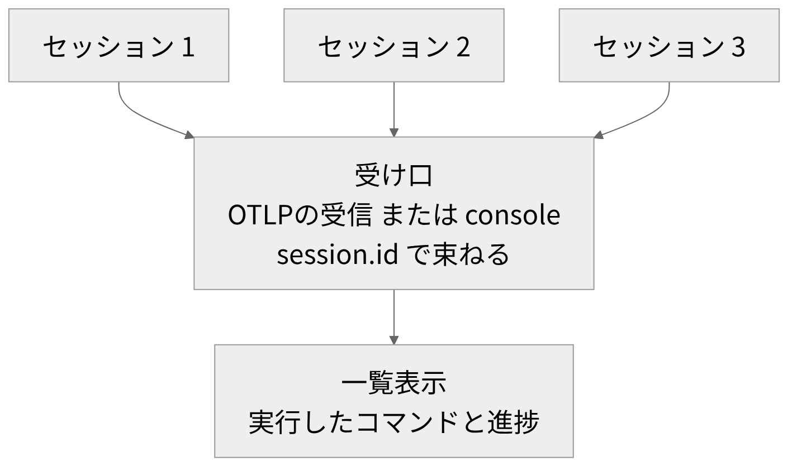

# Claude CodeのOpenTelemetry監視

<!-- さて、今日はClaude Codeの監視の話です。 -->
<!-- ここで言うセッションは、一つの会話の単位のことです。 -->
<!-- これが複数並ぶとき、全体を一か所で見たいと考えています。 -->
<!-- そのために、小さな監視アプリを検討しています。 -->
<!-- 規模は、ちょっとしたものに収めたいです。 -->
<!-- ただ、まだ実装はしていません。 -->
<!-- なので今日は、調べて分かったことを話します。 -->
<!-- まず仕組み、次に見えるもの、最後に構想の順です。 -->

---

<!-- header: "" -->
<!-- footer: "" -->

# Claude Codeが出すテレメトリー

<!-- まず、Claude Codeがどんなデータを出すのか、仕組みから確認します。 -->

---

<!-- header: Claude Codeが出すテレメトリー -->
<!-- footer: "https://code.claude.com/docs/en/monitoring-usage<br>https://opentelemetry.io/docs/concepts/signals/<br>https://opentelemetry.io/docs/specs/otel/logs/sdk_exporters/stdout/" -->

- OpenTelemetryの主なシグナルは traces / metrics / logs
- Claude Codeが出力するのは metrics と events(traces は beta、2026年10月時点)
- events は logs の一種。exporter(出力先)は otlp / console / none(metrics は prometheus も可)
- console は標準出力へ出す、デバッグ・学習向け(OpenTelemetryの仕様では本番非推奨、形式は標準化されていない)

```bash
# シェルまたはユーザー設定に書く(プロジェクト設定では無視される)
export CLAUDE_CODE_ENABLE_TELEMETRY=1
export OTEL_LOGS_EXPORTER=console
export OTEL_METRICS_EXPORTER=console
```

<!-- さて、まず仕組みの話です。 -->
<!-- 見たいのは、各セッションが何を実行し、どこまで進んだかです。 -->
<!-- そのために、OpenTelemetryの利用を検討しています。 -->
<!-- これは、テレメトリー、つまり動作の記録を出す枠組みです。 -->
<!-- 実際に出るのは、イベントとメトリクスです。 -->
<!-- つまり、メトリクスは集計用の数値です。 -->
<!-- なお、イベントはログの一種です。 -->
<!-- ここで、出力先の話です。 -->
<!-- 選ぶのは、エクスポーター、つまり出力先の種類です。 -->
<!-- その一つが、コンソールです。 -->
<!-- これは、標準出力に結果を出します。 -->
<!-- ただ、デバッグと学習向けの出力先です。 -->
<!-- 出力の形式も、標準化されていません。 -->
<!-- つまり、本番では推奨されません。 -->
<!-- 設定は、画面の例のとおりです。 -->
<!-- 書く場所は、シェルかユーザー設定です。 -->
<!-- 一方、プロジェクト設定では無視されます。 -->
<!-- ここまでが、仕組みです。 -->

---

<!-- header: "" -->
<!-- footer: "" -->

# console exporterで見えるもの

<!-- 次は、コンソールの出力から、実際に何が見えるのかを順に確認します。 -->

---

<!-- header: console exporterで見えるもの -->
<!-- footer: https://code.claude.com/docs/en/monitoring-usage -->

| 知りたいこと | イベント | 主な属性 |
|---|---|---|
| どのセッションか | 全イベント | session.id |
| 何を実行したか | tool_decision, tool_result | tool_name |
| 結果と所要時間 | tool_result | success, duration_ms |
| 進捗(推定) | user_prompt, api_request | event.timestamp, event.sequence |

- events: claude_code.user_prompt など
- metrics: claude_code.session.count など(8 種)
- prompt.id: プロンプトごとにイベントを束ねる ID
- 既定の出力間隔: events 5 秒、metrics 60 秒(2026年10月時点)

<!-- で、ここからが本題です。 -->
<!-- 動くたびに、イベントが出力されます。 -->
<!-- つまり、何かが起きた記録です。 -->
<!-- この表は、公式ドキュメントの説明をもとに作りました。 -->
<!-- まず、どのセッションかを知りたいときです。 -->
<!-- どのイベントにも、セッションのIDが付きます。 -->
<!-- ここがポイントです。 -->
<!-- 次に、何を実行したかです。 -->
<!-- ここで言うツールは、コマンド実行やファイル編集の機能です。 -->
<!-- 許可の判断と、実行結果の記録に、ツール名が入ります。 -->
<!-- 結果には、成功か失敗かと、所要時間も入ります。 -->
<!-- 最後に、どこまで進んだかです。 -->
<!-- 時刻と連番から、進み具合を推定します。 -->
<!-- なお、イベントは既定で、数秒ごとに出力されます。 -->
<!-- また、プロンプト、つまり指示文ごとに束ねるIDもあります。 -->
<!-- さらに、メトリクスは、別に出力されます。 -->
<!-- ここまでが、表の見方です。 -->

---

<!-- header: console exporterで見えるもの -->
<!-- footer: https://code.claude.com/docs/en/monitoring-usage -->

<style scoped>
pre { font-size: 0.8em; }
</style>

出力例(claude -p、Linux、ダミーAPI、Claude Code 2.1.295、2026年10月時点)

```text
  body: "claude_code.user_prompt",
  ...
    "session.id": "22f351f3-9f48-44de-bd1a-c74d2cd05dc7",
    prompt: "<REDACTED>",
  ...
  body: "claude_code.tool_result",
  ...
    tool_name: "Bash",
    success: "true",
    duration_ms: "136",
```

- 既定ではプロンプトは `<REDACTED>`、コマンドの本文は出力されない
- 本文の出力は OTEL_LOG_USER_PROMPTS=1 / OTEL_LOG_TOOL_DETAILS=1 で有効化(機密が混ざりうる)

【差し込み: 手元の実機のconsole出力(user.emailは伏せる)】

<!-- さて、実際の出力を見ます。 -->
<!-- これは、検証用のLinux環境で取った抜粋です。 -->
<!-- 一回だけ実行する形式で、接続先はダミーです。 -->
<!-- まず、形式です。 -->
<!-- これは、JSONではありません。 -->
<!-- 画面のとおり、キーに引用符のない行があります。 -->
<!-- 次に、中身です。 -->
<!-- 上は、プロンプトを送ったイベントです。 -->
<!-- ただ、その中身は、画面のとおり伏せ字です。 -->
<!-- 下は、ツールの実行結果です。 -->
<!-- ここには、ツール名が入ります。 -->
<!-- 成功したかと、所要時間も入ります。 -->
<!-- 一方、コマンドの中身は出力されません。 -->
<!-- 本文を出す設定は、画面の変数です。 -->
<!-- ただ、本文には機密が混ざる可能性があります。 -->
<!-- 会社や顧客のデータを扱う場合は、特に注意が必要です。 -->
<!-- (※ここで実体験を話す: 手元のClaude Codeで取ったconsole出力について) -->
<!-- ここまでが、出力の中身です。 -->

---

<!-- header: "" -->
<!-- footer: "" -->

# 小さな監視アプリの構想(検討中)

<!-- では最後に、検討中の小さな監視アプリの構想と、確認できた制約を話します。 -->

---

<!-- header: 小さな監視アプリの構想(検討中) -->
<!-- footer: https://code.claude.com/docs/en/monitoring-usage -->

検証環境での確認結果(Claude Code 2.1.295、2026年10月時点)

| 方式 | 結果 |
|---|---|
| console<br>対話 | 実行中は画面に出ない。デバッグログ(有効時)に記録 |
| console<br>非対話 | 標準出力。回答の文字列と混ざる |
| OTLP<br>対話 | http/json で送信。並行する対話セッション2つを1か所で受信し、session.id で区別できた |

公式ドキュメントに、この挙動の記載は確認できず

<!-- さて、まず確認できた制約を話します。 -->
<!-- ここは、検証環境で確認した結果です。 -->
<!-- 公式ドキュメントに、この挙動の記載は見つかりませんでした。 -->
<!-- まず、普段どおりの、対話で使う場合です。 -->
<!-- 実行中は、コンソールの出力が画面に出ません。 -->
<!-- ただ、調査用の記録、つまりデバッグログがあります。 -->
<!-- これを有効にすると、そこに残ります。 -->
<!-- 次に、一回だけ実行する、非対話の場合です。 -->
<!-- こちらは、標準出力に出ます。 -->
<!-- ただ、回答の文章と混ざります。 -->
<!-- つまり、対話の様子を見るには、別の方法が要ります。 -->
<!-- ここがポイントです。 -->
<!-- で、その一つが、受信する方法です。 -->
<!-- これは、OTLP、つまり標準の送信規格を使う方法です。 -->
<!-- 小さな受信サーバーに、直接送ります。 -->
<!-- 並行する複数の対話セッションが、一か所に届きました。 -->
<!-- 区別には、セッションのIDが使えます。 -->

---

<!-- header: 小さな監視アプリの構想(検討中) -->
<!-- footer: "https://opentelemetry.io/docs/what-is-opentelemetry/<br>https://code.claude.com/docs/en/monitoring-usage" -->



- 保存と表示は OpenTelemetry の対象外。表示側を自作する案(実装はこれから)
- 受け口は console と OTLP を比較して決める
- コマンド本文の表示には OTEL_LOG_TOOL_DETAILS=1 が必要
- 未確認: 許可待ちの検知(traces(beta)の claude_code.tool.blocked_on_user)

<!-- さて、ここからが構想です。 -->
<!-- まだ検討中です。 -->
<!-- 実装も、手元での確認も、これからです。 -->
<!-- 保存と表示は、OpenTelemetryの範囲外です。 -->
<!-- なので、表示の側を小さく作る案です。 -->
<!-- 図のとおり、複数のセッションを一か所で受けます。 -->
<!-- 束ねる単位は、セッションのIDです。 -->
<!-- 一覧には、実行したコマンドと進捗を出します。 -->
<!-- 進捗は、イベントの種類と時刻から推定します。 -->
<!-- で、受け口の候補は、コンソールとOTLPです。 -->
<!-- 後者は、送信先を環境変数で指定します。 -->
<!-- ここまでの確認では、OTLPのほうが対話向きです。 -->
<!-- ただ、コマンドの中身を出すには、画面の変数が要ります。 -->
<!-- もう一つ、まだ分かっていないことがあります。 -->
<!-- 許可待ちの検知です。 -->
<!-- 手がかりは、トレースにありますが、まだ試していません。 -->
<!-- ここは、これから確認します。 -->

---

<!-- header: "" -->
<!-- footer: "" -->

# まとめ

- Claude Codeは、metrics と events を OpenTelemetry で出力できる
- session.id で、並行する複数のセッションを見分けられる
- プロンプトとコマンドの本文は、既定で伏せられ、専用の設定で出力される
- console の出力先は、対話がデバッグログ、非対話が標準出力(検証環境)
- 受け口は console と OTLP を比較して決める。実装、手元での確認、許可待ちの検知はこれから

<!-- では、まとめます。 -->
<!-- まず、環境変数を設定すると、メトリクスとイベントが出力されます。 -->
<!-- 有効にする場所は、シェルかユーザー設定です。 -->
<!-- 次に、セッションのIDで、並行する複数のセッションを見分けられます。 -->
<!-- ここは、本文の扱いです。 -->
<!-- 既定では、プロンプトとコマンドの本文は伏せられます。 -->
<!-- 専用の設定をすると、出力されます。 -->
<!-- そして、コンソールの出力先です。 -->
<!-- 検証環境では、対話の場合はデバッグログに入ります。 -->
<!-- 非対話の場合は、標準出力に出ます。 -->
<!-- なので、対話を見るには、別の受け口が要ります。 -->
<!-- ここが要点です。 -->
<!-- 最後に、構想です。 -->
<!-- 受け口は、コンソールとOTLPを比べて決めます。 -->
<!-- 許可待ちの検知は、まだ確認できていません。 -->
<!-- 実装と、手元での確認は、これからです。 -->
<!-- 以上です。 -->
