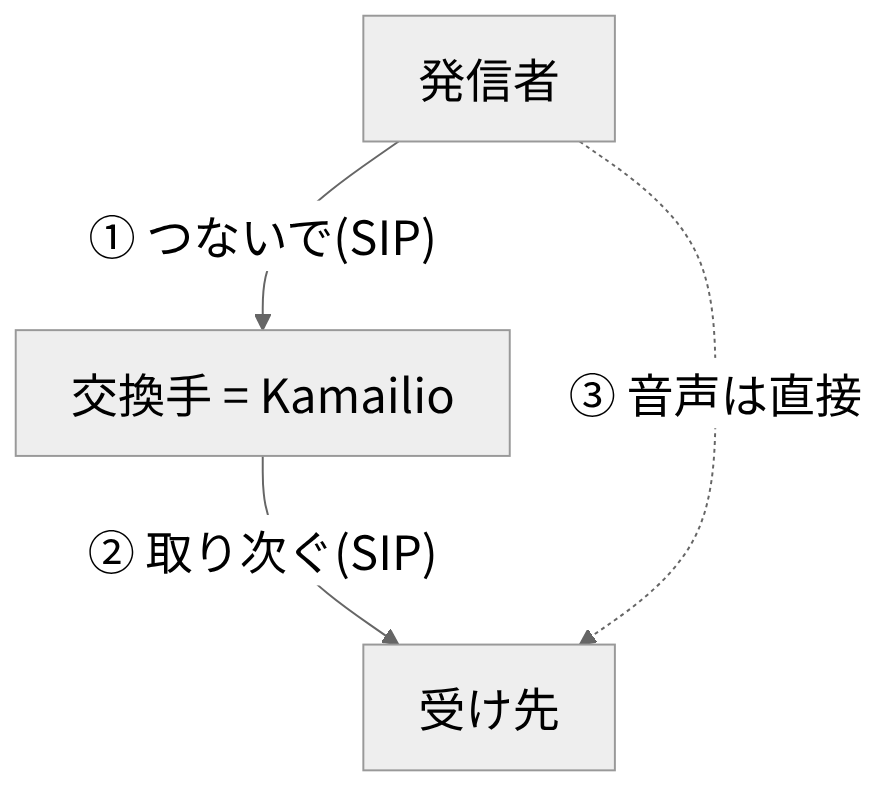

# Kamailio

<!-- さて、電話をかけると、どうして相手につながるのでしょうか。 -->
<!-- 今日は、その裏側にあるソフトの話です。 -->
<!-- ソフトの名前は、Kamailioといいます。 -->
<!-- ハワイ語で、「話す」という意味の言葉です。 -->
<!-- ソースが公開されていて、ライセンスはGPLです。 -->
<!-- 専門用語を知らなくても、大丈夫です。 -->
<!-- 用語は、最小限にします。 -->
<!-- 流れは、役割と設定と注意点の順です。 -->
<!-- 短い時間ですが、全体像をお話しします。 -->

---

<!-- header: "" -->
<!-- footer: "" -->

# SIPプロキシとは

<!-- さて、まずは電話をつなぐ交換手のたとえ話を、図で説明します。 -->

---

<!-- header: SIPプロキシとは -->
<!-- footer: https://www.rfc-editor.org/rfc/rfc3261<br>https://www.kamailio.org/wikidocs/tutorials/getting-started/main/<br>https://signalwire.com/developers/freeswitch -->



- SIP: 通話の開始・変更・終了を制御する取り決め
- プロキシ(図の交換手): SIPの要求を代理で取り次ぐ役
- たとえ話であり、音声は一般にSIPとは別の経路を通る

<!-- で、まず、この図を見てください。 -->
<!-- 上にいるのが、電話をかける人です。 -->
<!-- この人が、つないでほしい、と頼みます。 -->
<!-- この頼み方の決まりを、SIPといいます。 -->
<!-- つまり、通話の取り決めのことです。 -->
<!-- 頼みを受けて、相手に取り次ぐのが、交換手です。 -->
<!-- 受け先の居場所は、名簿を見て調べることもあります。 -->
<!-- この交換手の役を、プロキシと呼びます。 -->
<!-- つまり、取り次ぎ役のことです。 -->
<!-- この交換手になるソフトが、Kamailioです。 -->
<!-- ここがポイントです。 -->
<!-- つながったあとの音声は、一般に、交換手を通りません。 -->
<!-- 右側の点線が、音声の通り道です。 -->
<!-- かける人と受ける人が、直接やりとりします。 -->
<!-- ただ、たとえ話なので、厳密ではありません。 -->
<!-- 通話の中身を扱うのは、別のソフトの役目です。 -->
<!-- たとえば、FreeSWITCHのようなソフトです。 -->
<!-- 音声の中継が要るときも、別のソフトを足します。 -->

---

<!-- header: "" -->
<!-- footer: "" -->

# kamailio.cfgで動きを書く

<!-- 次は、この交換手がどうやって動きを決めるのかを、見ていきます。 -->

---

<!-- header: kamailio.cfgで動きを書く -->
<!-- footer: https://github.com/kamailio/kamailio/blob/6.1.4/doc/man/kamailio.cfg.5<br>https://www.kamailio.org/wikidocs/cookbooks/devel/core/<br>https://github.com/kamailio/kamailio/blob/6.1.4/README -->

- 動きは設定ファイル kamailio.cfg に書く
- 中身は、全体設定・モジュール読み込み・処理の流れ
- 処理は request_route から始まる
- 機能は、モジュール(部品)で足す
- registrar: 登録を受ける役(レジストラ)
- dispatcher: 振り分ける役(ロードバランサ)
- 【差し込み: 設定ファイルを書いた感想】

<!-- さて、Kamailioの動きは、設定ファイルに書きます。 -->
<!-- ファイルの名前は、画面のとおりです。 -->
<!-- 機能は、モジュール、つまり部品として足します。 -->
<!-- 機能の大半は、モジュールだと公式に書かれています。 -->
<!-- 設定ファイルの中身は、大きく三つに分かれます。 -->
<!-- 一つ目は、全体の設定です。 -->
<!-- 二つ目は、モジュールの読み込みです。 -->
<!-- 三つ目は、要求ごとの処理の流れです。 -->
<!-- 処理の入口は、request_routeです。 -->
<!-- 要求が届くたびに、ここから動きます。 -->
<!-- で、モジュールの例を二つ挙げます。 -->
<!-- 名簿に居場所を登録する役が、レジストラです。 -->
<!-- 受け先が複数のとき、振り分ける役が、ロードバランサです。 -->
<!-- 設定しだいで、入口の守り役にもなります。 -->
<!-- ここが特徴です。 -->
<!-- (※ここで実体験を話す: 設定ファイルを書いてみた感想について) -->
<!-- 以上が、設定ファイルの考え方です。 -->

---

<!-- header: kamailio.cfgで動きを書く -->
<!-- footer: https://kamailio.org/docs/modules/stable/modules/dispatcher.html<br>https://github.com/kamailio/kamailio/blob/6.1.4/etc/kamailio.cfg -->

```text
loadmodule "tm.so"
loadmodule "sl.so"
loadmodule "dispatcher.so"

request_route {
    if (!ds_select_dst("1", "4")) {
        send_reply("404", "No destination");
        exit;
    }
    t_relay();
}
```

- dispatcher の公式サンプルを最小化した動作確認用の例
- 実運用には、入力の検査や認証などの処理が必要

<!-- で、これが、ごく小さな設定の例です。 -->
<!-- 公式のサンプルを、短くしたものです。 -->
<!-- 動作確認用なので、本番向けではありません。 -->
<!-- ここから、中身を順に見ます。 -->
<!-- 上の三行で、モジュールを読み込みます。 -->
<!-- 一つ目は、状態を覚えながら取り次ぐモジュールです。 -->
<!-- 二つ目は、返事を返すモジュールです。 -->
<!-- 三つ目は、宛先を振り分けるモジュールです。 -->
<!-- 下の部分が、要求ごとの処理です。 -->
<!-- まず、宛先の候補から、順番に一つ選びます。 -->
<!-- 一つ目の数字は、宛先のグループを表します。 -->
<!-- 二つ目の数字は、選び方を表します。 -->
<!-- 選べなければ、エラーを返して終わります。 -->
<!-- 選べたら、その宛先へ取り次ぎます。 -->
<!-- 設定の本体は、これで全部です。 -->
<!-- 公式のサンプルは、もっと長い設定です。 -->
<!-- 本番では、検査や認証の処理も足します。 -->
<!-- 宛先の一覧は、別のファイルに書きます。 -->
<!-- これだけです。 -->

---

<!-- header: kamailio.cfgで動きを書く -->
<!-- footer: https://kamailio.org/docs/modules/stable/modules/dispatcher.html<br>https://www.kamailio.org/w/category/releases/ -->

- 宛先の一覧(dispatcher.list)

```text
1 sip:127.0.0.1:5080
1 sip:127.0.0.1:5090
```

- テスト用スクリプトで要求を4回送った結果

```text
$ python3 send_invite.py 4
INVITE 1: 200 OK  Contact: <sip:backend@127.0.0.1:5090>
INVITE 2: 200 OK  Contact: <sip:backend@127.0.0.1:5080>
INVITE 3: 200 OK  Contact: <sip:backend@127.0.0.1:5090>
INVITE 4: 200 OK  Contact: <sip:backend@127.0.0.1:5080>
```

- Kamailio 6.1.4(2026年10月時点の6.1系最新版)で実行

<!-- さて、検証環境で動かした結果です。 -->
<!-- まず、宛先の一覧です。 -->
<!-- 一行に一つ、宛先を書きます。 -->
<!-- 先頭の数字は、グループの番号です。 -->
<!-- 設定の中で、同じ番号を指定していました。 -->
<!-- 宛先は、手元の小さなプログラムです。 -->
<!-- 要求を送るのも、小さなスクリプトです。 -->
<!-- ここへ、電話をかける要求を、四回送りました。 -->
<!-- 送り先は、いつも入口の一か所だけです。 -->
<!-- 画面の結果を見てください。 -->
<!-- どの回も、OKと返ってきています。 -->
<!-- OKは、受け先が要求を受け入れた、という返事です。 -->
<!-- 返事の連絡先の欄で、どの宛先か分かります。 -->
<!-- 四回とも、きれいに交互になっています。 -->
<!-- ここに注目です。 -->
<!-- つまり、宛先が順番に振り分けられています。 -->
<!-- 宛先が止まったときに、次の宛先へ回す仕組みもあります。 -->
<!-- ここでは、その動きは試していません。 -->
<!-- これは、検証環境で出た結果です。 -->

---

<!-- header: "" -->
<!-- footer: "" -->

# つまずきやすい点

<!-- 最後に、設定を書くときにつまずきやすい点を、自分の学びとして話します。 -->

---

<!-- header: つまずきやすい点 -->
<!-- footer: https://kamailio.org/docs/modules/stable/modules/sl.html<br>https://github.com/kamailio/kamailio/blob/6.1.4/doc/man/kamailio.8<br>https://www.kamailio.org/wikidocs/cookbooks/ -->

- 学び: 設定関数は、実機に入れる前に公式ドキュメントで確認する
- 理由: デプロイ待ちを考えると、そのほうが全体で安い
- ドキュメントは、使う版のものを開く
- `kamailio -c` は構文と読み込み漏れを検出する(引数の意味は対象外)

```text
$ kamailio -c -f mini.cfg
ERROR: ... failed to find command send_reply (params 2)
CRITICAL: ... line 6, column 43: unknown command, missing loadmodule?
```

- 【差し込み: 実際に困った設定】

<!-- さて、まず、自分がどう関わったかをお話しします。 -->
<!-- 自分は、GCP上の音声システムの開発に関わりました。 -->
<!-- 構築には、Terraformを使いました。 -->
<!-- そこで使ったソフトの一つが、FreeSWITCHです。 -->
<!-- もう一つが、Kamailioです。 -->
<!-- その開発で、一つ学びました。 -->
<!-- 設定の関数は、実機に入れる前に、公式ドキュメントで確認します。 -->
<!-- そのほうが、デプロイ待ちを考えると、全体で安いからです。 -->
<!-- 公式ドキュメントは、版ごとに分かれています。 -->
<!-- 使う版のものを、開きます。 -->
<!-- 関数ごとに、引数の意味も書かれています。 -->
<!-- 画面のコマンドで、手元でも確認できます。 -->
<!-- たとえば、モジュールの読み込み漏れは、これで見つかります。 -->
<!-- ただし、引数の意味の誤りは、見つかりません。 -->
<!-- ここが大事です。 -->
<!-- 意味は、公式ドキュメントを読んで確かめます。 -->
<!-- (※ここで実体験を話す: Kamailioで実際に困った設定について) -->
<!-- 以上が、自分の学びです。 -->

---

<!-- header: "" -->
<!-- footer: "" -->

# まとめ

- Kamailio は SIP の取り次ぎ役(プロキシ)
- 通話の中身(音声)は、FreeSWITCH のような別のソフトが扱う
- 動きは kamailio.cfg に書き、機能はモジュールで足す
- 役割は広く、振り分けや登録、入口の守りも担える
- 設定の関数は、実機に入れる前に公式ドキュメントで確認する

<!-- さて、まとめです。 -->
<!-- つまり、このソフトは、SIPの取り次ぎ役です。 -->
<!-- 通話の中身は、別のソフトが扱います。 -->
<!-- 動きは、設定ファイルに書きます。 -->
<!-- 機能は、モジュールで足します。 -->
<!-- 動かした例では、宛先が順番に振り分けられました。 -->
<!-- 役割は広く、入口の守り役にもなります。 -->
<!-- これが、全体像です。 -->
<!-- 最後に、自分の学びです。 -->
<!-- 設定の関数は、実機に入れる前に、公式ドキュメントで確認します。 -->
<!-- そのほうが、デプロイ待ちを考えると、全体で安いです。 -->
<!-- 手元の確認コマンドも、使えます。 -->
<!-- ただし、引数の意味は、ドキュメントで確かめます。 -->
<!-- 以上です。 -->
