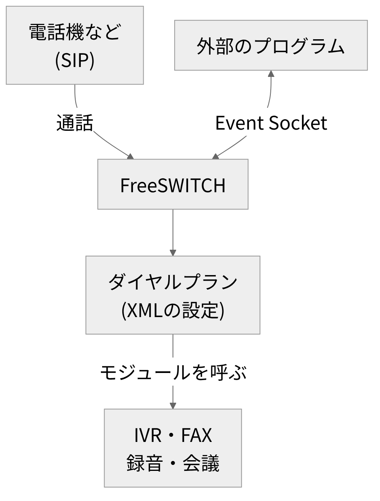

# FreeSWITCH

<!-- さて、電話をつなぐソフトの話から始めます。 -->
<!-- ソフトの名前は、FreeSWITCHといいます。 -->
<!-- 電話をつなぐだけでなく、通話の中身も扱えます。 -->
<!-- 中身とは、音声やFAXのことです。 -->
<!-- ソースが公開されていて、無料で使えます。 -->
<!-- 今日は、何ができるのかをお話しします。 -->
<!-- あわせて、入れるときの注意点も紹介します。 -->
<!-- 流れは、三つに分けます。 -->
<!-- 位置づけと、できることと、入れ方です。 -->
<!-- 画面の出力は、検証環境で取ったものです。 -->
<!-- 短い時間ですが、全体像をお伝えします。 -->

---

<!-- header: "" -->
<!-- footer: "" -->

# FreeSWITCHとは

<!-- さて、まずは、このソフトが何者かを公式の説明で確認します。 -->

---

<!-- header: FreeSWITCHとは -->
<!-- footer: https://developer.signalwire.com/freeswitch/foundations/introduction<br>https://github.com/signalwire/freeswitch/blob/v1.11.3/LICENSE<br>https://github.com/signalwire/freeswitch/releases/tag/v1.11.3<br>https://www.kamailio.org/w/<br>https://www.rfc-editor.org/rfc/rfc3261 -->

- 公式の説明: ソフトウェアのスイッチング基盤
- 対象は、音声・映像・テキストの通信
- 設定は XML に書く。標準の設定は SIP PBX として動く
- オープンソースで、ライセンスは MPL 1.1
- 最新のリリースは v1.11.3(2026年8月公開、2026年10月時点)
- 読み方は公式に記載なし。この発表ではフリースイッチと読む
- Kamailio は SIP サーバー。FreeSWITCH などの規模拡大に使える(Kamailio 公式)

<!-- さて、ここが基本の話です。 -->
<!-- 公式の説明では、音声と映像と文字の通信の基盤です。 -->
<!-- 電話機などの間をつないで、通話に処理を加えます。 -->
<!-- つまり、電話の交換機を、ソフトウェアで作るものです。 -->
<!-- 設定は、XMLのファイルに書きます。 -->
<!-- 標準の設定のままで、会社の電話交換機として動きます。 -->
<!-- ここでのSIPとは、通話を始めたり終えたりする取り決めです。 -->
<!-- ここがポイントです。 -->
<!-- ソースは公開されていて、ライセンスはMPLです。 -->
<!-- 最新のリリースの番号は、画面のとおりです。 -->
<!-- ところで、読み方は、公式に記載がありません。 -->
<!-- なので、この発表では、フリースイッチと呼びます。 -->
<!-- で、SIPの振り分け役は、別のソフトです。 -->
<!-- たとえば、Kamailioです。 -->
<!-- そちらの公式サイトには、FreeSWITCHなどの規模拡大に使える、とあります。 -->
<!-- 今日は、通話の中身を扱う側を話します。 -->

---

<!-- header: "" -->
<!-- footer: "" -->

# 通話の中身を扱う機能

<!-- さて、次は、通話の中身で何ができるのかを順に見ていきます。 -->

---

<!-- header: 通話の中身を扱う機能 -->
<!-- footer: https://developer.signalwire.com/freeswitch/applications/ivr-menus<br>https://developer.signalwire.com/freeswitch/applications/fax<br>https://developer.signalwire.com/freeswitch/applications/conferencing<br>https://developer.signalwire.com/freeswitch/dialplan/dptools<br>https://developer.signalwire.com/freeswitch/integration/event-socket -->



- IVR(自動音声応答): ivr アプリケーション
- FAX: mod_spandsp
- 録音: record_session
- 会議: mod_conference
- 外部からの制御: mod_event_socket
- 図は、公式の説明をもとにした概念図

<!-- さて、機能を順番に見ていきます。 -->
<!-- まず、右の図を見てください。 -->
<!-- この図は、公式の説明をもとにした概念図です。 -->
<!-- 左上が、電話機などの相手です。 -->
<!-- 通話は、FreeSWITCHに入ります。 -->
<!-- 中では、ダイヤルプランが手順を決めます。 -->
<!-- ダイヤルプラン、つまり着信後の手順を書いた設定です。 -->
<!-- その手順から、機能のモジュールを呼びます。 -->
<!-- 一つ目は、IVRです。 -->
<!-- つまり、自動音声応答のことです。 -->
<!-- 番号を押すと、次の案内に進む仕組みです。 -->
<!-- メニューは、XMLで書きます。 -->
<!-- 二つ目は、FAXの送信と受信です。 -->
<!-- 三つ目は、録音と会議です。 -->
<!-- 最後は、外から操作する窓口です。 -->
<!-- 名前は、Event Socketといいます。 -->
<!-- 外のプログラムが、命令を送れて、結果も受け取れます。 -->

---

<!-- footer: https://developer.signalwire.com/freeswitch/applications/fax<br>https://developer.signalwire.com/freeswitch/integration/event-socket<br>https://www.itu.int/rec/T-REC-T.30/en -->

- 確認の順(設計案): 切断理由、FAX の成否(T.30)、ページ数
- 検証環境で取った実際の出力。疑似の通話で実行。失敗は送るファイルなし

```text
event plain CHANNEL_HANGUP_COMPLETE
bgapi originate loopback/9178/default 9179 XML default

(成功)  Hangup-Cause: NORMAL_CLEARING
        fax_success: 1
        fax_document_transferred_pages: 1
(失敗)  Hangup-Cause: NORMAL_CLEARING
        fax_success: 0
        fax_document_transferred_pages: 0
        fax_result_text: The call dropped prematurely
```

- 【差し込み: 実際に FAX を送受信できたか、使ってみた感想】

<!-- ここからは、FAXの結果の読み方です。 -->
<!-- 画面の上の二行が、実際に送った命令です。 -->
<!-- 一行目で、通話が終わったときのイベントを受け取る設定をします。 -->
<!-- 二行目で、疑似の通話を発信して、FAXを送ります。 -->
<!-- 疑似の通話とは、実際の電話回線を使わない通話のことです。 -->
<!-- 結果は、そのイベントの変数に入っています。 -->
<!-- で、再試行を考えるとき、見る順番を検討しました。 -->
<!-- 切断理由、FAXの成否、ページ数の順です。 -->
<!-- FAXの成否は、T.30という規格の結果です。 -->
<!-- T.30、つまりFAXの通信手順を定めた規格のことです。 -->
<!-- これは設計の検討で、運用した話ではありません。 -->
<!-- 下の出力は、検証環境で取った実際の結果です。 -->
<!-- ここに注目です。 -->
<!-- 切断理由は、成功も失敗も、正常終了です。 -->
<!-- ただ、失敗の例では、FAXの成否が失敗になっています。 -->
<!-- 送るファイルが、なかったからです。 -->
<!-- つまり、切断理由だけでは、成否が分かりません。 -->
<!-- 実際の電話回線やFAX機では、試していません。 -->
<!-- (※ここで実体験を話す: 実際にFAXを送受信できたか、使ってみた感想について) -->
<!-- 以上が、FAXの結果の読み方です。 -->

---

<!-- header: "" -->
<!-- footer: "" -->

# 入れ方とつまずきやすい点

<!-- さて、最後は、入れ方とつまずきやすい点をお話しします。 -->

---

<!-- header: 入れ方とつまずきやすい点 -->
<!-- footer: https://developer.signalwire.com/freeswitch/foundations/getting-started -->

- 入れ方は2通り: パッケージ、またはソースビルド
- パッケージ: SignalWire のリポジトリから入れる。Personal Access Token が必要
- ソースビルド: GitHub のコードから作る。トークンは不要
- 公式: Debian・Ubuntu では、パッケージが最短
- 公式: パッケージにないモジュールが要るときは、ソースから
- 発表者の経験: Docker(Ubuntu 22.04)でソースからビルド
- パッケージとは、モジュールの有無に差があった(発表者の経験)
- 画面の出力は、ソースからビルドした v1.11.3 のもの

<!-- さて、入れ方は、二通りあります。 -->
<!-- 一つは、パッケージで入れる方法です。 -->
<!-- 画面に書いたOSなら、公式は、これが最短としています。 -->
<!-- 開発元のSignalWireの、リポジトリから入れます。 -->
<!-- これには、アカウントで作るトークンが必要です。 -->
<!-- トークン、つまり認証用の合言葉のことです。 -->
<!-- もう一つは、ソースからビルドする方法です。 -->
<!-- こちらは、トークンが要りません。 -->
<!-- ここがポイントです。 -->
<!-- パッケージにないモジュールが要るなら、ソースからビルドします。 -->
<!-- これは、公式にも書かれている使い分けです。 -->
<!-- 自分は、Dockerの中で、ソースからビルドしました。 -->
<!-- OSは、Ubuntuです。 -->
<!-- パッケージと比べると、モジュールの有無に差がありました。 -->
<!-- なお、画面の出力は、ソースからビルドした版のものです。 -->

---

<!-- footer: https://github.com/signalwire/freeswitch/blob/v1.11.3/configure.ac<br>https://github.com/signalwire/freeswitch/blob/v1.10.12/configure.ac<br>https://github.com/signalwire/freeswitch/blob/v1.11.3/build/modules.conf.in<br>https://packages.ubuntu.com/jammy/libspandsp-dev<br>https://github.com/signalwire/freeswitch/releases/tag/v1.11.3 -->

- ソースビルドでは、依存ライブラリを先に作る(v1.11.3 の configure.ac で確認)
- 必須: spandsp 3.1.1 以上(FAX)、sofia-sip 1.13.18 以上(SIP)
- 既定のモジュール一覧では、libks2 2.0.11 以上と signalwire-c 2.0.0 以上も必要
- 版は変わる: spandsp は v1.10.12 で 3.0 以上、v1.11.3 で 3.1.1 以上
- Ubuntu 22.04 の libspandsp-dev は 0.0.6 で、どちらにも足りない
- v1.11.3 のリリースノート: Debian 11 は対象外(dropped)
- 【差し込み: ビルドで詰まった点】

<!-- で、次が、つまずきやすい点です。 -->
<!-- ソースから作るときは、先に作る部品があります。 -->
<!-- 画面は、最新のリリースの設定ファイルで確認した内容です。 -->
<!-- 必須の部品は、二つです。 -->
<!-- FAXを扱う部品と、SIPを扱う部品です。 -->
<!-- 標準のモジュール一覧では、さらに二つ要ります。 -->
<!-- ここがポイントです。 -->
<!-- 必要な版は、リリースごとに変わります。 -->
<!-- FAXの部品で、画面の数字を見比べてください。 -->
<!-- 今のリリースでは、求める版が上がっています。 -->
<!-- つまり、古い版のままでは、先に進めません。 -->
<!-- Ubuntuの標準の部品は、さらに古い版です。 -->
<!-- なので、部品もソースから作ります。 -->
<!-- もう一つ、OSの古さにも注意が必要です。 -->
<!-- 最新のリリースでは、古いDebianの版が対象から外れました。 -->
<!-- (※ここで実体験を話す: ビルドで実際に詰まった点について) -->
<!-- 以上が、つまずきやすい点です。 -->

---

<!-- header: "" -->
<!-- footer: "" -->

# まとめ

- FreeSWITCH は、通話の中身(音声・FAX)まで扱えるオープンソースの交換機
- IVR・FAX・録音・会議は、モジュールが提供し、ダイヤルプランから呼ぶ
- Event Socket で外から操作でき、FAX の成否は切断理由だけでは判断できない
- 入れ方は、トークンが要るパッケージと、要らないソースビルドの2通り
- 依存ライブラリの版は、リリースごとに変わる。ビルド前に確認する

<!-- さて、まとめです。 -->
<!-- つまり、このソフトは、通話の中身まで扱う交換機です。 -->
<!-- 機能は、モジュールで足して、ダイヤルプランから呼びます。 -->
<!-- 外からの操作は、Event Socketを使います。 -->
<!-- FAXの結果は、切断理由だけでは分かりません。 -->
<!-- 成否の変数と、ページ数も見ます。 -->
<!-- 動かした例は、疑似の通話での確認です。 -->
<!-- 実際の回線では、確認していません。 -->
<!-- 入れ方は、二通りあります。 -->
<!-- パッケージにはトークンが要り、ソースビルドには要りません。 -->
<!-- ソースビルドでは、部品の版が、リリースごとに変わります。 -->
<!-- なので、作る前に、対象の版の設定を確認します。 -->
<!-- 以上です。 -->
