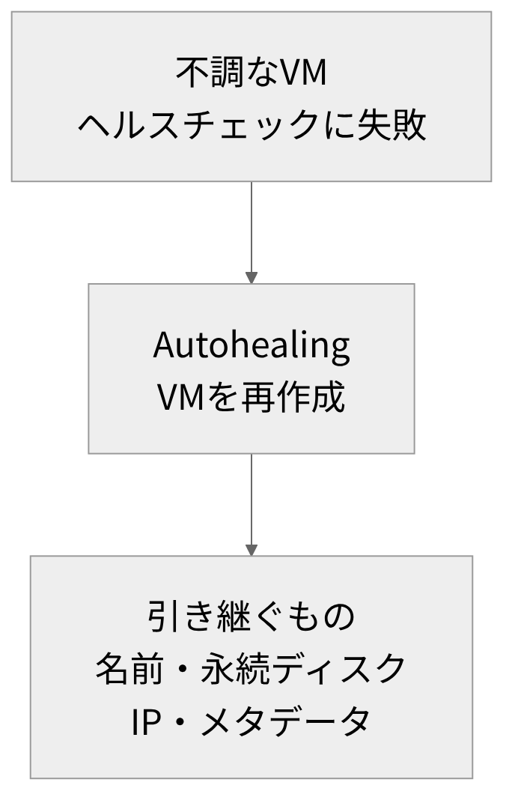

# オンプレ脳、クラウド脳

<!-- さて、今日は、オンプレ脳とクラウド脳の話です。 -->
<!-- 先に言うと、これは意見の話です。 -->
<!-- つまり、どちらが正しいか、という話ではありません。 -->
<!-- 最初に脳の意味、次に三つの違い、最後に切り替えどころです。 -->
<!-- よろしくお願いします。 -->

---

<!-- header: "" -->
<!-- footer: "" -->

# 「脳」が違う、とは

<!-- まず、脳が違うとはどういうことなのか、整理するところから始めます。 -->

---

<!-- header: 「脳」が違う、とは -->
<!-- footer: https://nvlpubs.nist.gov/nistpubs/Legacy/SP/nistspecialpublication800-145.pdf -->

- 「脳」は発表者の呼び方で、判断の出発点になる前提を指す
- 例(仮定): サーバー1台が停止。オンプレ脳はまず直し、クラウド脳はまず替える
- 置き場所より前提の違い
  - NISTの定義では、プライベートクラウドは敷地内にも置ける
- 発表者: CTI/PBXなどオンプレ寄りの経験が長く、近年はGoogle CloudとTerraformのプロジェクトにも参加
- 比べる軸: 用意する、壊れたとき、お金

<!-- さて、この題名は、自分で考えたものです。 -->
<!-- オンプレ中心の人と、クラウド中心の人。 -->
<!-- その二つで、考え方が大きく違うと感じた経験が、少しあります。 -->
<!-- ここでの脳は、判断の出発点になる前提のことです。 -->
<!-- つまり、何を当たり前と考えるか、の違いです。 -->
<!-- ここが大事です。 -->
<!-- たとえば、サーバーが一台止まったとします。 -->
<!-- オンプレ脳は、まず、その一台を直そうと考えます。 -->
<!-- 一方、クラウド脳は、まず新しい一台に替えようと考えます。 -->
<!-- 同じ事故でも、最初の一手が変わります。 -->
<!-- これは、場所の違いというより、前提の違いだと考えています。 -->
<!-- アメリカの標準機関の定義でも、敷地内に置くクラウドが含まれます。 -->
<!-- ちなみに自分は、電話系のオンプレ寄りの経験が長いです。 -->
<!-- 最近は、クラウドを使う仕事にも関わりました。 -->
<!-- その違いを、三つの軸で比べます。 -->
<!-- 用意する、壊れたとき、お金の三つです。 -->

---

<!-- header: "" -->
<!-- footer: "" -->

# 3つの違い

<!-- ここから、オンプレ脳とクラウド脳の違いを、三つの軸で見ていきます。 -->

---

<!-- header: 3つの違い -->
<!-- footer: https://www2.eecs.berkeley.edu/Pubs/TechRpts/2009/EECS-2009-28.pdf https://docs.aws.amazon.com/whitepapers/latest/aws-overview/six-advantages-of-cloud-computing.html https://learn.microsoft.com/en-us/training/modules/describe-cloud-compute/6-describe-consumption-based-model -->

| 軸 | オンプレ脳 | クラウド脳 |
|---|---|---|
| 用意する | 最大の負荷を想定し、 先に調達する | 必要な分を、 必要なときに借りる |
| 壊れたとき | 壊れないよう守り、 壊れたら直す | 壊れる前提で作り、 壊れたら置き換える |
| お金 | 買うときに決める 初期投資(CapEx) | 使った分だけ払う 従量課金(OpEx) |

用意する時間は、AWSの説明では週単位から分単位に縮まる
表は発表者の整理。用意する速さが、容量とお金の考え方を決める

<!-- さて、まず全体を、一枚の表で見ます。 -->
<!-- 一つ目は、用意する、という軸です。 -->
<!-- オンプレ脳は、最大の負荷を想定して、先に用意します。 -->
<!-- 理由は、足りなくなると、困るからです。 -->
<!-- 発注して、届いて、置いてから使います。 -->
<!-- 一方、クラウド脳は必要な分を、必要なときに借ります。 -->
<!-- 必要なら増やし、余れば減らします。 -->
<!-- ある事業者の説明では、用意する時間が、週単位から分単位に縮まります。 -->
<!-- 二つ目は、壊れたときです。 -->
<!-- オンプレ脳は、壊れないように守ります。 -->
<!-- で、クラウド脳は、壊れる前提で作ります。 -->
<!-- これは、次で詳しく話します。 -->
<!-- 三つ目は、お金です。 -->
<!-- オンプレ脳は、買うときに決めます。 -->
<!-- 一度買えば、購入費は決まっています。 -->
<!-- それに対し、クラウド脳は、使った分だけ払います。 -->
<!-- 使わない分は、止めれば請求も減ります。 -->
<!-- もし、止め忘れると、請求は続きます。 -->
<!-- 用意する速さが、容量とお金の考え方を決めます。 -->
<!-- ここまでは、自分なりの整理です。 -->

---

<!-- header: 3つの違い -->
<!-- footer: https://cloudscaling.com/blog/cloud-computing/the-history-of-pets-vs-cattle/ https://docs.cloud.google.com/architecture/framework/security/shared-responsibility-shared-fate -->

- 「ペットと家畜」のたとえ(Randy Bias、2016年の経緯の記事)
- ペット: 唯一の存在。手で世話をし、二重化して守る
- 家畜: 数でそろえる。壊れる前提で作り、自動で入れ替える
- オンプレ脳はペット寄り、クラウド脳は家畜寄り(発表者の整理)
- 基盤インフラの責任は、クラウドでは事業者。疑う出発点が変わる(発表者の整理)

【差し込み: 障害対応で、最初に疑う場所が違うと感じた場面】

<!-- 次は、壊れたときの考え方です。 -->
<!-- ここで、ペットと家畜のたとえを使います。 -->
<!-- 名前をつけて手で世話をする一台が、ペットです。 -->
<!-- 二重化した一組も、ペットとして扱われます。 -->
<!-- 止められないから、手をかけて守ります。 -->
<!-- それに対して、家畜は、自動で作って数でそろえます。 -->
<!-- 一匹欠けても、群れは困りません。 -->
<!-- 理由は、壊れたら自動で入れ替えるからです。 -->
<!-- オンプレ脳は、ペットに近い発想です。 -->
<!-- 一方、クラウド脳は、家畜に近い発想です。 -->
<!-- それぞれ、良い点があります。 -->
<!-- 自分は、手で直せる安心感はペット側にあると思います。 -->
<!-- 自動で戻れる強さは、家畜側にあると思います。 -->
<!-- 実は、どちらも、壊れることは知っています。 -->
<!-- 違うのは、壊れたあとの扱いです。 -->
<!-- もう一つ、責任の範囲も違います。 -->
<!-- オンプレでは、機器まで自分の担当です。 -->
<!-- しかし、クラウドでは、機器は事業者の担当です。 -->
<!-- つまり、疑う出発点が変わります。 -->
<!-- (※ここで実体験を話す: 障害対応で、最初に疑う場所が違った場面について) -->
<!-- ここがポイントです。 -->

---

<!-- header: "" -->
<!-- footer: "" -->

# どちらにも理がある

<!-- ここから、オンプレ脳にもクラウド脳にも理がある、という話をします。 -->

---

<!-- header: どちらにも理がある -->
<!-- footer: https://docs.cloud.google.com/compute/docs/instance-groups/stateful-migs https://docs.cloud.google.com/compute/docs/instance-groups/about-repair https://docs.cloud.google.com/compute/docs/instance-groups/preserved-state -->

- 検討した設計(運用実績はない)
  - 状態を持つPBXを、Stateful MIG と Autohealing(Google Cloud)に任せる
- 公式ドキュメントの注意(2026年10月時点)
  - 壊れたディスクも引き継がれ、自動復旧で直らないことがある
- 発表者の読み取り
  - 引き継ぎの説明に、メモリ状態の記載はない

【差し込み: 検討・評価の結果と、そのとき感じたこと】

<!-- さて、状態を持つサーバーの例を見ます。 -->
<!-- たとえば、通話中の状態を持つ、電話の交換機です。 -->
<!-- これを、クラウドの自動復旧に任せる設計を、検討しました。 -->
<!-- あくまで検討と評価で、運用した実績はありません。 -->
<!-- 使う仕組みは、二つです。 -->
<!-- 一つは、ステートフルMIGです。 -->
<!-- つまり、サーバーごとの状態を保てる、グループのことです。 -->
<!-- もう一つは、オートヒーリングです。 -->
<!-- つまり、自動復旧のことです。 -->
<!-- 流れは、画面の図を見てください。 -->
<!-- 不調なサーバーは、作り直されます。 -->
<!-- そのとき、名前やディスクなどは、引き継がれます。 -->
<!-- 注意点です。 -->
<!-- もし、ディスクが壊れていると、そのまま引き継がれることがあります。 -->
<!-- そこで、公式は、起動用のディスクに状態を持たせないよう勧めています。 -->
<!-- また、自分の読みでは、公式の説明に通話中の状態はありません。 -->
<!-- (※ここで実体験を話す: 検討・評価の結果と、そのとき感じたことについて) -->
<!-- つまり、置き換える部分と守る部分を、分けて考えます。 -->

---

<!-- header: どちらにも理がある -->
<!-- footer: https://docs.cloud.google.com/architecture/framework/reliability/horizontal-scalability https://docs.cloud.google.com/docs/cuds https://cloud.google.com/distributed-cloud -->

切り替えの問い(発表者の整理)

| 問い | オンプレ脳寄り | クラウド脳寄り |
|---|---|---|
| 状態を失えるか | 失えない 守る部分を分けて守る | 失える、または外に出せる ステートレス設計 |
| 負荷が読めるか | 読めて安定 期間を約束して固定費に | 読めず変動 従量課金と自動増減 |
| 置き場所の制約は | ある 遅延やデータの所在 | ない 事業者に任せる |

クラウド側にも、期間を約束する割引や、敷地内に置く製品がある(2026年10月時点)

<!-- では、どこで切り替えるか、です。 -->
<!-- 自分の整理です。 -->
<!-- 問いは、三つあります。 -->
<!-- 一つ目は、状態を失えるか、です。 -->
<!-- 失えるなら、本体は使い捨てにできます。 -->
<!-- 状態を外に出す、という設計です。 -->
<!-- この設計は、クラウド事業者の指針でも、勧められています。 -->
<!-- 失えないなら、守る部分を分けて決めます。 -->
<!-- 二つ目は、負荷が読めるか、です。 -->
<!-- 読めて安定なら、固定費に寄せる手があります。 -->
<!-- 実は、クラウドにも、期間を約束して安くする仕組みがあります。 -->
<!-- 読めずに変動するなら、自動で増減する方が合います。 -->
<!-- 三つ目は、置き場所の制約です。 -->
<!-- 遅れの少なさや、データの所在地を、求められる場合があります。 -->
<!-- その場合は、敷地内に置く製品も、事業者から出ています。 -->
<!-- つまり、どれも、答えは一つではありません。 -->
<!-- 問いに答えて、前提を選ぶ、ということです。 -->

---

<!-- header: "" -->
<!-- footer: "" -->

# まとめ

- 考え方の差は、判断の前提の差から生まれる
- 前提は、用意する・壊れたとき・お金の3点で分かれる
- 固定して守る設計にも、置き換えて増減する設計にも、理がある(発表者の意見)
- 状態の有無、負荷の読みやすさ、置き場所の制約が、切り替えの判断材料になる
- 守る部分と置き換える部分を分けて設計する

<!-- 最後に、まとめます。 -->
<!-- まず、考え方の違いは、判断の前提の違いから生まれます。 -->
<!-- 前提が分かれるのは、三つの場面です。 -->
<!-- 用意するとき、壊れたとき、お金を払うときです。 -->
<!-- オンプレ脳は、固定して守る設計に理があります。 -->
<!-- 一方、クラウド脳は、置き換えて増減する設計に理があります。 -->
<!-- つまり、どちらにも、それぞれの出番があります。 -->
<!-- 切り替えの材料は、状態と負荷と置き場所です。 -->
<!-- 守る部分と置き換える部分を、分けて設計します。 -->
<!-- 脳という言葉は、自分のラベルです。 -->
<!-- 今日は、切り替えどころを考える話でした。 -->
<!-- これが、今日の自分の意見です。 -->
<!-- 聞いてくださって、ありがとうございます。 -->
