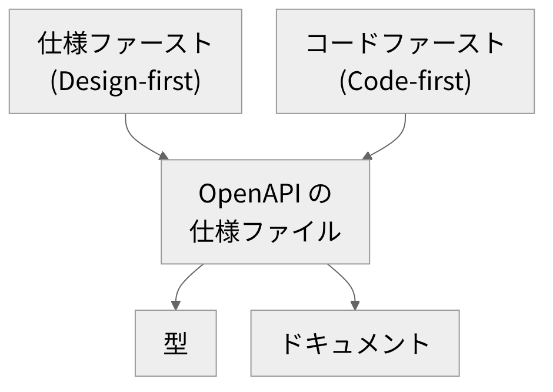

# OpenAPI

<!-- さて、今日は OpenAPI の話をします。 -->
<!-- ひとことで言うと、仕様を真ん中に置く話です。 -->
<!-- 流れは、三つです。 -->
<!-- まず、OpenAPI とは何か。 -->
<!-- 次に、仕様から型を作る例を、実際の出力で見ます。 -->
<!-- 最後に、仕様の作り方の話です。 -->
<!-- なお、コマンドは読み上げず、画面を見てもらいます。 -->
<!-- よろしくお願いします。 -->

---

<!-- header: "" -->
<!-- footer: "" -->

# OpenAPIとは

<!-- さて、まずは OpenAPI とは何かを、短くおさらいします。 -->

---

<!-- header: OpenAPIとは -->
<!-- footer: https://spec.openapis.org/oas/latest.html<br>https://www.openapis.org/about -->

- OpenAPI Specification(OAS): HTTP API を記述する標準仕様(言語に依存しない)
- 仕様ファイルは YAML または JSON(推奨名は openapi.yaml か openapi.json)
- ドキュメント生成・コード生成・テストなどのツールで使える
- 策定は OpenAPI Initiative(OAI)、Linux Foundation 配下の団体
- OAI は、ベンダー中立な記述形式を掲げる
- もとは、SmartBear が寄贈した Swagger Specification
- 最新版は 3.2.1(2026年10月時点)、末尾の数字は修正・補足のみ

<!-- さて、OpenAPI です。 -->
<!-- つまり、ウェブの API を書き表す、標準の仕様のことです。 -->
<!-- 入り口と、データの受け渡しを、決まった形で書きます。 -->
<!-- しかも、特定の言語には、縛られません。 -->
<!-- ここは大事です。 -->
<!-- この標準で書いたものを、仕様ファイルと呼びます。 -->
<!-- その形式は、画面のとおりです。 -->
<!-- で、この仕様ファイルを、いろいろなツールが読めます。 -->
<!-- 例は、ドキュメントの表示とコードの生成、テストなどです。 -->
<!-- 仕様を決めているのは、OAI という団体です。 -->
<!-- そして、特定の一社に寄らない、中立な形をうたっています。 -->
<!-- 運営は、Linux Foundation の下です。 -->
<!-- もとは、Swagger という名前の仕様でした。 -->
<!-- 最新の版は、画面のとおりです。 -->
<!-- 前の二つの数字が、機能の区切りです。 -->
<!-- 後ろの数字は、誤りの修正や補足です。 -->

---

<!-- header: "" -->
<!-- footer: "" -->

# 仕様から型を作る

<!-- 次は、小さな仕様を使って、型を作る流れを順番に見ていきます。 -->

---

<!-- header: 仕様から型を作る -->
<!-- footer: https://spec.openapis.org/oas/latest.html<br>https://learn.openapis.org/best-practices -->

```yaml
openapi: 3.1.0
paths:
  /orders/{order_id}:
    get:
      ...
              schema: { $ref: "#/components/schemas/Order" }
components:
  schemas:
    Order:
      type: object
      required: [id, status]
      properties:
        id: { type: string }
        status: { type: string, enum: [pending, paid, shipped] }

```

<!-- さて、これが小さな仕様です。 -->
<!-- そのファイルは、YAML というテキスト形式で書きます。 -->
<!-- なお、細かい項目は、画面では省いています。 -->
<!-- 上から仕様の版、API の入り口、データの形です。 -->
<!-- で、入り口は、ひとつだけです。 -->
<!-- それは、注文を取得する、GET です。 -->
<!-- 波かっこの部分は、注文を指定する値です。 -->
<!-- その応答が、下の Order を指しています。 -->
<!-- この参照のおかげで、同じ定義を、何度も書かずに済みます。 -->
<!-- 下のほうが、データの形を置く場所です。 -->
<!-- で、Order には、項目がふたつあります。 -->
<!-- ひとつ目は、id です。 -->
<!-- ふたつ目が、status です。 -->
<!-- 必須の項目も、ここで指定します。 -->
<!-- その status は、決まった候補の文字列だけです。 -->
<!-- 実際の仕様は、もっと長くなります。 -->
<!-- 今回は、短い例にしています。 -->
<!-- あとで効きます。 -->

---

<!-- footer: https://openapi-ts.dev/introduction<br>https://openapi-ts.dev/cli -->

```bash
$ npm i -D openapi-typescript typescript
$ npx openapi-typescript ./openapi.yaml -o ./schema.d.ts
openapi-typescript 7.13.0
./openapi.yaml → ./schema.d.ts [233.6ms]

```

```ts
...
Order: {
    id: string;
    /** @enum {string} */
    status: "pending" | "paid" | "shipped";
};
...
```

- 実行結果は openapi-typescript 7.13.0(2026年10月時点)
- ツールの公式ドキュメントの対応版は OpenAPI 3.0 と 3.1(2026年10月時点)

<!-- で、次は、この仕様から型を作ります。 -->
<!-- まず、ツールを入れます。 -->
<!-- 名前は、画面のとおりです。 -->
<!-- そして、型を作るのは、画面のふたつ目のコマンドです。 -->
<!-- 入力は、さっきの仕様ファイルです。 -->
<!-- 公式の説明では、仕様はネット上のアドレスでも渡せます。 -->
<!-- 出力は、型だけのファイルです。 -->
<!-- さらに、実行時のコードは、含まれません。 -->
<!-- そのあと、画面に、かかった時間が出ます。 -->
<!-- さて、結果です。 -->
<!-- 見ると、Order が、型として出力されています。 -->
<!-- id と status が、仕様どおりに並びます。 -->
<!-- その status は、仕様に書いた候補だけを許す型です。 -->
<!-- つまり、仕様の情報が、型の形で残ります。 -->
<!-- ほかにも、API の入り口や応答の型が、出力されます。 -->
<!-- なお、この仕様の版は、ツールが対応する版に合わせました。 -->
<!-- 最新の版とは、違う点に注意です。 -->

---

<!-- footer: https://openapi-ts.dev/introduction<br>https://www.typescriptlang.org/tsconfig/#noEmit -->

```ts
import type { components } from "./schema";

type Order = components["schemas"]["Order"];

export const isPaid = (order: Order) => order.status === "paid";

```

仕様の変更: status → state(型を再生成して、型チェックを実行)

```
$ npx tsc --noEmit
client.ts(5,47): error TS2339: Property 'status' does not exist
on type '{ id: string; state: "pending" | "paid" | "shipped"; }'.

```

【差し込み: 実務で型生成を使って、型のズレが減った(または困った)実体験】

<!-- さて、この型を使う側のコードです。 -->
<!-- 上のほうが、クライアント側のコードです。 -->
<!-- その関数は、支払い済みかどうかを調べます。 -->
<!-- さっきの型を、読み込んで使っています。 -->
<!-- ここで、サーバー側の仕様が変わったとします。 -->
<!-- そのとき、画面の矢印のとおり、項目の名前が変わります。 -->
<!-- で、仕様を直して、同じコマンドで型を作り直します。 -->
<!-- そのあと、型のチェックを実行します。 -->
<!-- なお、型のチェックは、TypeScript 本体のコマンドが行います。 -->
<!-- すると、画面の下のとおり、エラーになります。 -->
<!-- status という項目は、もう存在しない、という内容です。 -->
<!-- つまり、動かす前に、ズレが見つかります。 -->
<!-- もし、候補の文字列を変えても、同じように見つかります。 -->
<!-- どちらも、動かす前の段階で分かります。 -->
<!-- ここがポイントです。 -->
<!-- (※ここで実体験を話す: 実務で型生成を使って、型のズレが減った(または困った)経験について) -->
<!-- ここまでが、型の話です。 -->

---

<!-- header: "" -->
<!-- footer: "" -->

# 仕様ファーストとコードファースト

<!-- ここから、仕様の作り方がふたつある、という話をしていきます。 -->

---

<!-- header: 仕様ファーストとコードファースト -->
<!-- footer: https://learn.openapis.org/best-practices<br>https://fastapi.tiangolo.com/tutorial/first-steps/ -->



- OAI のガイドは仕様ファーストを推奨
- コードファーストの例: FastAPI は、書いたコードから仕様を自動で作る
- どちらの流れでも、型を作る手順は変わらない

<!-- さて、仕様の作り方は、ふたつあります。 -->
<!-- ひとつは、仕様ファーストです。 -->
<!-- 先に仕様を書いて、あとからコードを書きます。 -->
<!-- もうひとつは、コードファーストです。 -->
<!-- 先にコードを書いて、そこから仕様を作ります。 -->
<!-- 例えば、Python 製の FastAPI は、この流れで仕様を自動で作ります。 -->
<!-- さらに、仕様からは、型もドキュメントも作れます。 -->
<!-- つまり、どちらでも、型を作る手順は同じです。 -->
<!-- 実は、OAI のガイドは、仕様ファーストを勧めています。 -->
<!-- 理由は、コードで作れる API が、仕様で書ける範囲より広いからです。 -->
<!-- ここがポイントです。 -->
<!-- どちらの流れを選んでも、仕様さえあれば、型を作る手順は変わりません。 -->

---

<!-- header: "" -->
<!-- footer: "" -->

# まとめ

- OpenAPI は、HTTP API を記述する標準仕様
- 仕様を中心に置くと、型とドキュメントを機械的に作れる
- 仕様の変更は、型の再生成で型エラーとして見つかる(今回の例)
- OAI のガイドは仕様ファーストを推奨、型の生成はどちらの流れでも同じ

<!-- さて、まとめです。 -->
<!-- まず、OpenAPI は、ウェブの API を書き表す標準の仕様です。 -->
<!-- そして、仕様を中心に置くと、型やドキュメントを機械的に作れます。 -->
<!-- 今回の例では、型を作り直すと、エラーで気づけました。 -->
<!-- 仕様を直したのに、コードを直し忘れることがあります。 -->
<!-- そういうズレを、動かす前に見つけられます。 -->
<!-- また、仕様の作り方には、ふたつの流れがあります。 -->
<!-- その中で、OAI のガイドは、仕様ファーストを勧めています。 -->
<!-- ですが、型を作る手順は、どちらでも同じです。 -->
<!-- まず、小さな仕様で、試してみてください。 -->
<!-- 以上です。 -->
<!-- 最後まで、聞いてくださって、ありがとうございます。 -->
