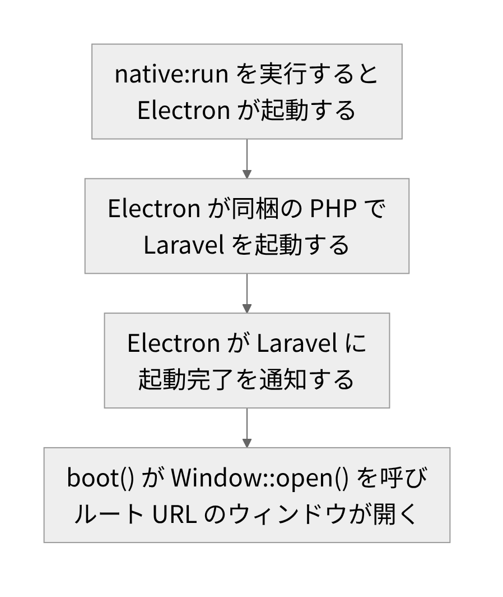

# NativePHP

<!-- さて、今日はNativePHPの話をします。 -->
<!-- 自分は、PHPとLaravelを、仕事で使ってきました。 -->
<!-- ここでは、デスクトップアプリを作るまでの道筋を、公式の情報で整理します。 -->
<!-- 流れは、三つです。 -->
<!-- まず、NativePHPとは何かを、見ます。 -->
<!-- 次に、手順です。 -->
<!-- 最後に、利点と注意です。 -->
<!-- 内容は、公式のドキュメントと、リポジトリで確認したものに絞っています。 -->
<!-- なお、バージョンや料金は、今の時点の情報です。 -->

---

<!-- header: "" -->
<!-- footer: "" -->

# NativePHPとは

<!-- さて、まずはNativePHPが何なのかを、公式の説明とリポジトリで確認します。 -->

---

<!-- header: NativePHPとは -->
<!-- footer: https://nativephp.com/docs/desktop/2/getting-started/introduction<br>https://nativephp.com/docs/mobile/getting-started/introduction<br>https://www.electronjs.org/<br>https://github.com/NativePHP/desktop<br>https://github.com/NativePHP/mobile-air<br>https://bifrost.nativephp.com/ -->

- PHP と Laravel でネイティブアプリを作るフレームワーク(2026年10月時点)
- Desktop 版: Electron の外枠に静的 PHP を同梱(最新タグ 2.3.1)
- Mobile 版: Swift / Kotlin の外枠に PHP を埋め込む(最新タグ 4.6.0)
- 画面: Desktop は HTML / CSS / JavaScript、Mobile は標準でネイティブ UI
- ライセンス: 本体はどちらも MIT
- 料金: 有料の周辺サービスあり(例: クラウドビルドの Bifrost は月10ドルから)

<!-- さて、これはPHPとLaravelで、ネイティブアプリを作るフレームワークです。 -->
<!-- 一つ目は、デスクトップ版です。 -->
<!-- 外枠には、Electronを使います。 -->
<!-- つまり、ブラウザの部品を組み込める土台です。 -->
<!-- その中に、PHPを同梱します。 -->
<!-- ここでの画面は、HTMLなどのWeb技術で作ります。 -->
<!-- 二つ目は、モバイル版です。 -->
<!-- こちらは、iOSとAndroid向けです。 -->
<!-- それぞれの外枠に、PHPを埋め込みます。 -->
<!-- こちらの画面は、標準でネイティブの部品を使います。 -->
<!-- 次は、お金の話です。 -->
<!-- 本体のライセンスは、どちらもMITです。 -->
<!-- これは、オープンソースのライセンスの一つです。 -->
<!-- つまり、本体は無料で使えます。 -->
<!-- ただ、有料の周辺サービスも、あります。 -->
<!-- たとえば、クラウドでビルドする有料サービスです。 -->
<!-- なお、料金や版は、今の時点の情報です。 -->

---

<!-- header: "" -->
<!-- footer: "" -->

# Hello Worldまでの手順

<!-- 次は、Hello Worldまでの手順を、公式ドキュメントのとおりに見ます。 -->

---

<!-- header: Hello Worldまでの手順 -->
<!-- footer: https://nativephp.com/docs/desktop/2/getting-started/installation<br>https://nativephp.com/docs/desktop/2/getting-started/support-policy<br>https://github.com/NativePHP/desktop<br>https://laravel.com/docs/13.x/releases -->

- 前提(2026年10月時点): PHP 8.3 以上 / Laravel 11 以上 / Node 22 以上
- 対応 OS: Windows 10 以上 / macOS 12 以上 / Linux
- 対応表: PHP 8.3, 8.4 / Laravel 11.x, 12.x(最新の Laravel は 13.x)
- composer.json の illuminate/contracts は ^13 まで許容(2.3.1、動作は未確認)
- 公式の推奨: native:run の前に、まずブラウザで動作を確認する

```bash
# 公式ドキュメントの例
composer require nativephp/desktop
php artisan native:install
php artisan native:run
```

<!-- さて、手順は、公式ドキュメントのとおりです。 -->
<!-- まず、前提です。 -->
<!-- ここでは、PHPとLaravelに加えて、Nodeも要ります。 -->
<!-- これは、外枠の部品を、Nodeで取得するためです。 -->
<!-- 対応OSは、WindowsとmacOSとLinuxです。 -->
<!-- 既存のアプリにも、新しいアプリにも、入れられます。 -->
<!-- そして、手順は三つのコマンドです。 -->
<!-- 一つ目は、本体を入れるコマンドです。 -->
<!-- 使うのは、PHPのパッケージ管理ツール、composerです。 -->
<!-- 二つ目は、初期設定のコマンドです。 -->
<!-- 三つ目は、アプリを起動するコマンドです。 -->
<!-- ただ、一つ注意があります。 -->
<!-- 対応表には、最新のLaravelが載っていません。 -->
<!-- 一方で、依存の指定には、最新の版も入ります。 -->
<!-- 最新のLaravelで動くかは、未確認です。 -->
<!-- 公式は、先にブラウザで動かすことを勧めています。 -->

---

<!-- header: Hello Worldまでの手順 -->
<!-- footer: https://nativephp.com/docs/desktop/2/getting-started/installation<br>https://github.com/NativePHP/php-bin<br>https://www.electronjs.org/ -->

- native:install: 設定追加、composer.json 更新、Electron 用依存の取得
- native:install 自体は未実行。下の出力は Linux x64 で確認した範囲

```bash
# desktop 2.3.1 の resources/electron で npm install した後
$ node -p "require('electron/package.json').version"
40.10.2
# php-bin 1.2.0 の linux/x64/php-8.3.zip を展開した php
$ ldd ./php
	not a dynamic executable
$ ./php -v | head -1
PHP 8.3.31 (cli) (built: May 21 2026 01:45:33) (NTS x86_64-linux-musl-gcc)
$ ./php -m | grep -i pdo
PDO
pdo_sqlite
```

<!-- で、次は、初期設定のコマンドの中身です。 -->
<!-- まず、設定ファイルと、起動時に動くクラスを足します。 -->
<!-- 次に、composerのファイルへ、スクリプトを加えます。 -->
<!-- 最後に、外枠の部品を、ダウンロードします。 -->
<!-- ここから、画面の実行結果です。 -->
<!-- ただ、installコマンド自体は、実行していません。 -->
<!-- 見たのは、外枠の部品と、同梱のPHPです。 -->
<!-- 一つ目は、外枠の版です。 -->
<!-- 二つ目は、同梱されるPHPです。 -->
<!-- 静的PHP、つまり、ライブラリごと一つにまとめたPHPです。 -->
<!-- 次のコマンドは、ほかのライブラリへの依存を調べます。 -->
<!-- 結果は、ほかに頼っていない、という意味です。 -->
<!-- ここがポイントです。 -->
<!-- つまり、利用者の端末にPHPがなくても、動かせます。 -->
<!-- 最後のコマンドは、データベースの拡張を調べます。 -->
<!-- 入っているのは、SQLite用だけです。 -->

---

<!-- header: Hello Worldまでの手順 -->
<!-- footer: https://github.com/NativePHP/desktop<br>https://nativephp.com/docs/desktop/2/the-basics/windows<br>https://nativephp.com/docs/desktop/2/digging-deeper/security -->



```php
// NativeAppServiceProvider(雛形)
public function boot(): void
{
    Window::open();
}
```

ソースの記述に基づく(実機は未確認)

【差し込み: 開いたウィンドウの画面】

<!-- さて、起動のコマンドの後は、この流れです。 -->
<!-- まず、Electronが起動します。 -->
<!-- 次に、同梱のPHPで、Laravelが立ち上がります。 -->
<!-- そして、外枠が、Laravelに起動完了を伝えます。 -->
<!-- このやり取りは、鍵つきの通信で行われます。 -->
<!-- 鍵は、起動のたびに作り直されます。 -->
<!-- どちらも、セキュリティの章に書かれています。 -->
<!-- ここがポイントです。 -->
<!-- その連絡を受けて、左のコードが実行されます。 -->
<!-- このコードは、公式の雛形のとおりです。 -->
<!-- 中の一行が、ウィンドウを開きます。 -->
<!-- 大きさなども、ここで指定できます。 -->
<!-- 開く先は、Laravelのトップページです。 -->
<!-- つまり、ブラウザで見ていた画面が、そのままウィンドウになります。 -->
<!-- (※ここで実体験を話す: 実際にウィンドウが開いたときの様子について) -->
<!-- なお、この流れは、ソースを読んで確認した内容です。 -->
<!-- 実機での起動は、未確認です。 -->

---

<!-- header: "" -->
<!-- footer: "" -->

# Laravel開発者にとっての利点と注意

<!-- 最後は、Laravelを使ってきた人にとっての、利点と注意を公式の記載で見ます。 -->

---

<!-- header: Laravel開発者にとっての利点と注意 -->
<!-- footer: https://nativephp.com/docs/desktop/2/getting-started/introduction<br>https://nativephp.com/docs/desktop/2/getting-started/env-files<br>https://nativephp.com/docs/desktop/2/digging-deeper/databases<br>https://nativephp.com/docs/desktop/2/getting-started/development<br>https://nativephp.com/docs/desktop/2/publishing/building -->

- **利点** 新しいフレームワークの学習は不要(Laravel の上に構築)
- **利点** UI は自由(Livewire / Inertia / React / Vue など)
- **注意** .env も配布物に含まれる。秘密情報は入れない
- **注意** 標準対応の DB は SQLite のみ
- **注意** コードの変更は再起動で反映(ホットリロードは一部)
- **注意** ビルドは一度に 1 つの OS 向け。macOS / Windows は署名が必要

【差し込み: NativePHP を実際に触った範囲と、使ってみた感想】

<!-- さて、まず利点です。 -->
<!-- 公式の説明から、二つ挙げます。 -->
<!-- 一つ目は、新しいフレームワークを覚え直さずに済むことです。 -->
<!-- 二つ目は、画面を、好きな技術で作れることです。 -->
<!-- 利用者側の準備が要らない点は、さきほど見たとおりです。 -->
<!-- 次は、注意です。 -->
<!-- まず、環境ファイルも、アプリに含まれます。 -->
<!-- つまり、秘密の情報は、入れないのが前提です。 -->
<!-- 次に、データベースです。 -->
<!-- 標準で使えるのは、SQLiteだけです。 -->
<!-- これは、ファイルで動く、軽量なデータベースです。 -->
<!-- 実際、同梱のPHPには、ほかのDB拡張がありません。 -->
<!-- それから、コードを直したら、再起動が必要です。 -->
<!-- ただ、一部の変更は、自動で反映されます。 -->
<!-- 最後に、ビルドは、一度に一つのOS向けです。 -->
<!-- 配る前に、macOSとWindowsは署名が必要です。 -->
<!-- (※ここで実体験を話す: 実際に触った範囲と、使ってみた感想について) -->
<!-- どれも、公式の記載で確認した内容です。 -->

---

<!-- header: "" -->
<!-- footer: "" -->

# まとめ

- 位置づけは、PHP と Laravel で作るネイティブアプリのフレームワーク
- ライセンスは、本体が MIT(有料の周辺サービスは別にある)
- 中身は、静的 PHP と Electron の組み合わせ(Desktop 版)
- 手順は、公式ドキュメントの例で 3 コマンド(対応表は Laravel 12.x まで)
- 配布前の確認点は、.env の同梱、SQLite のみ、OS ごとのビルドと署名

<!-- さて、まとめです。 -->
<!-- 一つ目は、位置づけです。 -->
<!-- これは、PHPとLaravelで作る、ネイティブアプリのフレームワークです。 -->
<!-- 二つ目は、ライセンスです。 -->
<!-- 本体は、MITです。 -->
<!-- 有料の周辺サービスは、別にあります。 -->
<!-- 三つ目は、中身です。 -->
<!-- ここでは、デスクトップ版の話です。 -->
<!-- 外枠は、Electronです。 -->
<!-- その中に、静的なPHPが入っています。 -->
<!-- 四つ目は、手順です。 -->
<!-- 公式の例では、Hello Worldまでが三つのコマンドです。 -->
<!-- ただ、対応表には、最新のLaravelが載っていません。 -->
<!-- 五つ目は、配る前の確認点です。 -->
<!-- 環境ファイルの同梱と、データベースの制限です。 -->
<!-- それに、OSごとのビルドと、署名です。 -->
<!-- 公式のセキュリティの章に、くわしい注意があります。 -->
<!-- どれも、今の時点の公式の情報です。 -->
<!-- 以上です。 -->
