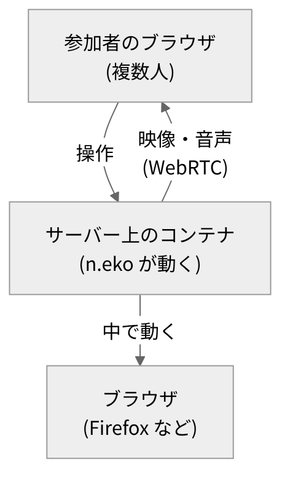
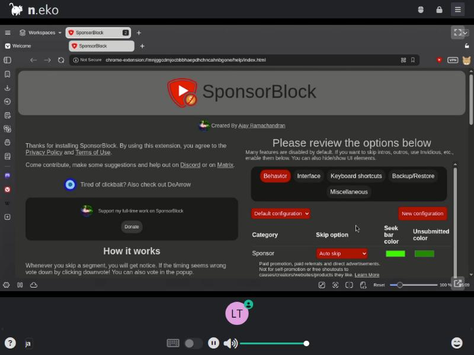
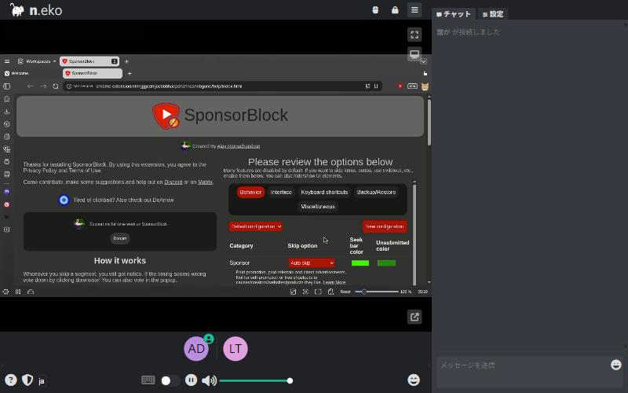
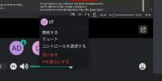
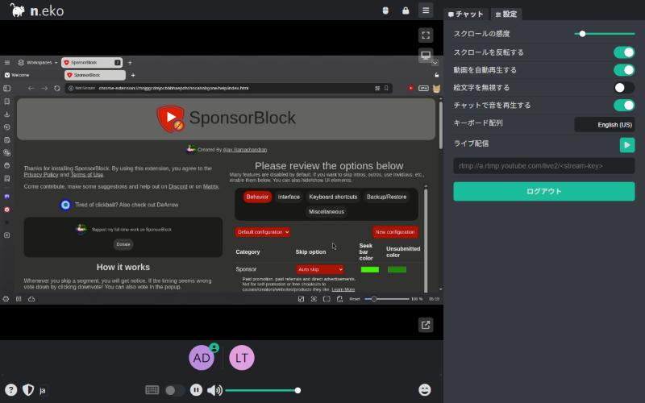
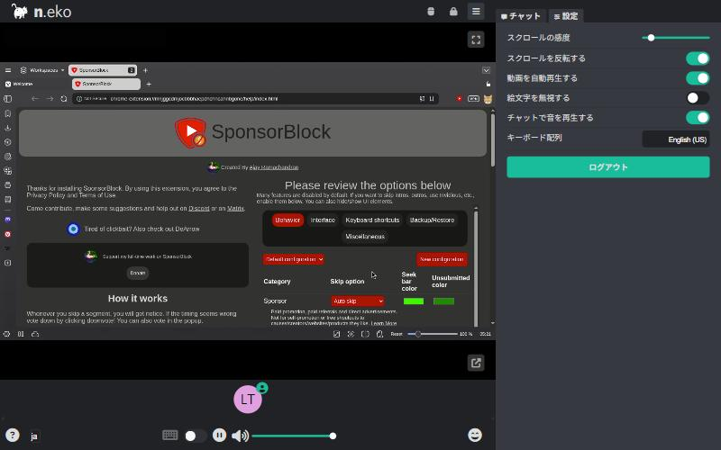
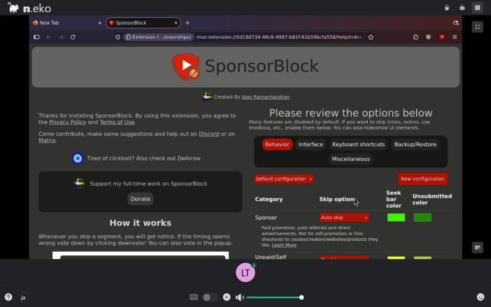

# n.eko を､崇めよ ((≡ﾟ♀ﾟ≡))

<!-- それでは、始めます。 -->
<!-- 今日は、n.ekoの話です。 -->
<!-- これは、ブラウザを、みんなで一緒に使うツールです。 -->
<!-- 内容は、公式の記載をもとにしています。 -->
<!-- 話は、二つに分けます。 -->
<!-- まず、n.ekoとは何か。 -->
<!-- 次に、動かし方と、注意点です。 -->

---

<!-- header: "" -->
<!-- footer: "" -->

# n.ekoとは


<!-- さて、まずはn.ekoがどんなツールか、公式の説明で確認します。 -->

---

<!-- header: n.ekoとは -->
<!-- footer: https://neko.m1k1o.net/<br>https://github.com/m1k1o/neko<br>https://github.com/m1k1o/neko/releases/tag/v3.1.6 -->

- Dockerで動く、セルフホスト型の仮想ブラウザ(公式の説明)
- 1つのブラウザを、複数人がリモートで共有する
- 操作権限は、参加者の間で受け渡せる
- 遅延は、公式の記載では300ミリ秒未満
- ライセンスは Apache-2.0
- 最新版は v3.1.6(2026年9月30日公開、2026年10月時点)
- 名前の由来: READMEに、Nekoは日本語の「猫」とある(読み方は公式に記載なし)

<!-- これは、セルフホスト型の仮想ブラウザです。 -->
<!-- つまり、セルフホストとは、自分のサーバーで動かす形のことです。 -->
<!-- で、仮想ブラウザとは、サーバーの上で動くブラウザのことです。 -->
<!-- 中身は、Dockerのコンテナです。 -->
<!-- ここまでが、概要です。 -->
<!-- で、一つのブラウザを、複数人で共有します。 -->
<!-- 操作する権利は、参加者の間で受け渡せます。 -->
<!-- 操作を求められたとき、断ることもできます。 -->
<!-- 公式は、遅延の少なさもうたっています。 -->
<!-- 数字は、画面のとおりです。 -->
<!-- ただ、これは公式の主張で、検証はしていません。 -->
<!-- あと、ライセンスと最新の版も、画面に出しました。 -->
<!-- 版は、今月時点のものです。 -->
<!-- ところで、名前の読み方は、公式に記載がありません。 -->
<!-- ただ、READMEにはNekoは日本語の猫、とあります。 -->
<!-- なので、この発表では、ネコと呼びます。 -->

---

<!-- footer: https://neko.m1k1o.net/<br>https://github.com/m1k1o/neko<br>https://webrtc.org/ -->



- ブラウザは、サーバー側のコンテナで動く
- 手元に届くのは、映像と音声(WebRTC)
- 参加者の操作は、サーバーに送られる
- 公式の記載: Cookieなどは転送されない

<!-- 次は、仕組みを、図で見ます。 -->
<!-- 図の矢印は、通信の向きを表します。 -->
<!-- 上が、参加者のブラウザです。 -->
<!-- 複数人が、同時につなぎます。 -->
<!-- 真ん中が、サーバー上のコンテナです。 -->
<!-- この中で、n.ekoが動きます。 -->
<!-- 下が、コンテナの中のブラウザです。 -->
<!-- ここでは、Firefoxなどが動きます。 -->
<!-- ここがポイントです。 -->
<!-- 実は、ブラウザの実体は、サーバー側にあります。 -->
<!-- 参加者に届くのは、映像と音声です。 -->
<!-- その送り方が、WebRTCです。 -->
<!-- つまり、ブラウザで映像や音声を、やり取りする仕組みです。 -->
<!-- そして、参加者の操作は、サーバーに送られます。 -->
<!-- すると、サーバーのブラウザが動いて、結果が映像で返ります。 -->
<!-- 公式の記載では、Cookieなどのデータは、手元に送られません。 -->
<!-- 映像と音声だけが、共有されます。 -->

---

<!-- footer: https://neko.m1k1o.net/<br>https://github.com/m1k1o/neko<br>https://playwright.dev/<br>https://pptr.dev/ -->

- Watch Party: 複数人で動画を一緒に見る
- Interactive Presentation: 操作権限を渡しながら進める
- Collaborative Tool と Support/Teaching: 共同作業、遠隔での指導やサポート
- Embed Anything: 自分のWebアプリにブラウザを組み込む
- Automated Browser: PlaywrightやPuppeteerを入れて自動操作
- Throwaway Browser: 終了後に履歴やCookieが残らない(公式の記載)
- 【差し込み: 使ってみたい用途、または使った場面】

<!-- 次は、使い道です。 -->
<!-- 公式サイトには、用途の例が並んでいます。 -->
<!-- まずは、動画を一緒に見る使い方です。 -->
<!-- 見ながら、リアルタイムで反応できます。 -->
<!-- 実は、READMEによると、元の作者は友人とアニメを見たくて作ったそうです。 -->
<!-- 次に、操作を渡す使い方です。 -->
<!-- 授業や発表で、参加者に操作を任せられます。 -->
<!-- 共同作業や、遠隔サポートにも使えます。 -->
<!-- で、自分のWebアプリに、組み込むこともできます。 -->
<!-- 外部のサイトも、そのまま開けます。 -->
<!-- また、ブラウザを自動で操作するツールも、中に入れられます。 -->
<!-- 名前は、画面のとおりです。 -->
<!-- 使い捨てのブラウザとしても、使えます。 -->
<!-- 公式の記載では、終了後に、履歴やCookieが残りません。 -->
<!-- (※ここで実体験を話す: 使ってみたい用途、または使った場面について) -->
<!-- どれも、サーバー側のブラウザを共有する形です。 -->

---

<!-- header: "" -->
<!-- footer: "" -->

# 動かし方と注意点

<!-- 次は、動かし方と注意点を、公式の記載に沿って順に見ていきます。 -->

---

<!-- header: 動かし方と注意点 -->
<!-- footer: https://neko.m1k1o.net/docs/v3/quick-start<br>https://docs.docker.com/compose/ -->

公式 Quick start の手順

1. 公開IPのあるサーバーを用意する
2. Docker と Docker Compose プラグインを入れる
3. compose ファイルを取得して起動する

   ```shell
   wget https://raw.githubusercontent.com/m1k1o/neko/master/docker-compose.yaml
   sudo docker compose up -d
   ```

4. ブラウザでサーバーのIPを開き、ログインする(既定のパスワードは neko)

推奨スペック(公式の表): 1280x720@30 は 4コア・3GB で Good Performance

<!-- 手順は、四つです。 -->
<!-- まず、公開IPのあるサーバーを用意します。 -->
<!-- 必要なスペックの目安は、公式の表にあります。 -->
<!-- 数字は、画面のとおりです。 -->
<!-- 公式は、なぜスペックが必要かも、書いています。 -->
<!-- 理由は、デスクトップとブラウザを動かして、映像も作って送るからです。 -->
<!-- 次に、Dockerを入れます。 -->
<!-- あわせて、Composeのプラグインも入れます。 -->
<!-- つまり、コンテナの設定を、ファイルに書いて動かす仕組みです。 -->
<!-- で、三つ目は設定ファイルの取得と、起動です。 -->
<!-- どちらも、画面のコマンドのとおりです。 -->
<!-- 自宅や社内のネットワークで試すなら、追加の設定が要ります。 -->
<!-- その設定は、次のスライドで見ます。 -->
<!-- 最後に、ブラウザで、サーバーのIPを開きます。 -->
<!-- で、ログイン画面が出たら、パスワードを入れます。 -->
<!-- 既定のパスワードは、公式に書かれています。 -->

---

<!-- footer: https://github.com/m1k1o/neko/blob/master/docker-compose.yaml<br>https://neko.m1k1o.net/docs/v3/configuration/webrtc -->

```yaml
services:
  neko:
    image: "ghcr.io/m1k1o/neko/firefox:latest"
    ...
    ports:
      - "8080:8080"                    # 画面(HTTP)
      - "52000-52100:52000-52100/udp"  # WebRTC用のUDP
    environment:
      NEKO_WEBRTC_EPR: 52000-52100     # 上のUDPと同じ範囲
      ...
      NEKO_WEBRTC_NAT1TO1: <your-IP>   # クライアントが接続するIP
```

公式の docker-compose.yaml から抜粋(2026年10月時点)
書式だけでなく、実際にローカルで起動して動作も確認済み

<!-- で、こちらが、設定ファイルの要点です。 -->
<!-- 公式のファイルから、抜き出しました。 -->
<!-- まず、イメージの名前です。 -->
<!-- 今回は、Firefoxの版です。 -->
<!-- 次に、ポートの設定です。 -->
<!-- 一つ目は、画面を開くための、HTTPのポートです。 -->
<!-- 二つ目は、映像と音声のための、UDPのポートです。 -->
<!-- ここがポイントです。 -->
<!-- 映像と音声は、HTTPとは別の通信で送ります。 -->
<!-- なので、映像と音声は、nginxなどの中継サーバーを通せません。 -->
<!-- 次に、環境の設定です。 -->
<!-- 一行目の値は、UDPの範囲と、同じにします。 -->
<!-- ずらさずに公開することが大事、と公式にあります。 -->
<!-- 最後は、接続先のIPです。 -->
<!-- ここは、自分の環境の値に、置き換えます。 -->
<!-- 書式だけでなく、実際に自分の環境で起動まで確認できました。 -->

---

<!-- footer: "" -->



ログイン後、コンテナ内のVivaldiがそのまま画面に表示される
体感はChromeリモートデスクトップに近く、同じようなもっさり感もある

<!-- 実際に、自分の手元でも起動してみました。 -->
<!-- ログインすると、さっきの図の下側にあったコンテナの中のブラウザが、そのまま画面に出てきます。 -->
<!-- つないだ直後は映像がまだ来なくて、数秒待つと表示されました。 -->
<!-- 感触としては、技術的に近いところがありそうなChromeリモートデスクトップに似ていて、同じように妙なもっさり感がありました。 -->
<!-- とはいえ、まだガッツリ使い込んだわけではないので、そのくらいの参考にしてもらえればと。 -->

---

 

- 右上のメニューから、参加者一覧とチャット/設定パネルを開ける
- 参加者を右クリックすると、コントロールを渡す・ミュート・追い出す・バンができる

<!-- 複数人での使い方も、実際に2つのタブで試してみました。 -->
<!-- 片方を管理者、もう片方を一般ユーザーとして、同じ部屋につないでいます。 -->
<!-- 参加者を右クリックすると、こういうメニューが出てきて、実際に操作権限を渡すこともできました。 -->
<!-- ミュート・追い出し・バンもできるので、荒らし対策の権限もひと通り揃っています。 -->
<!-- これが、さっき話した「操作権限を受け渡せる」の中身です。 -->

---

 

- 管理者の設定には「ライブ配信(RTMP)」欄と鍵アイコンがある(左)
- 一般ユーザーの設定にはどちらもない(右)

<!-- 設定パネルも、管理者と一般ユーザーで見比べてみました。 -->
<!-- 左が管理者、右が一般ユーザーです。 -->
<!-- 管理者側には、ライブ配信、いわゆるRTMP配信の欄があります。 -->
<!-- あと、画面右上の鍵アイコンも、管理者にしか出ていませんでした。 -->
<!-- 一般ユーザー側には、この2つがどちらもありません。 -->

---

<!-- footer: https://neko.m1k1o.net/docs/v3/installation/docker-images -->



- Firefox系(Firefox, Tor Browser, Waterfox)とChromium系(Chromium, Google Chrome, Vivaldi, Edge, Operaなど)のイメージが公式に用意されている
- Safariは配布ライセンスの制約で非対応(公式)

<!-- イメージは、Vivaldi以外も試せます。 -->
<!-- 今回はFirefox版も起動して、同じ手順でつながることを確認しました。 -->
<!-- 公式には、Firefox系とChromium系、合わせていくつもの種類が用意されています。 -->
<!-- ちなみにSafariだけは、ライセンスの都合で公式には用意されない、と書かれていました。 -->
<!-- ここまでが、動かし方です。 -->

---

<!-- footer: https://neko.m1k1o.net/docs/v3/configuration/authentication<br>https://neko.m1k1o.net/docs/v3/installation<br>https://neko.m1k1o.net/docs/v3/troubleshooting<br>https://neko.m1k1o.net/docs/v3/customization/networking -->

- パスワードは2種類。ユーザー用(既定 neko)、管理者用(既定 admin)
- 既定値は公式ドキュメントに載っている
- 公開前に変更を決める(発表者の整理)
- 認証なし(noauth)は、誰でも管理者として入れる。本番では要注意(公式)
- NAT1TO1の127.0.0.1は同じ端末で試すとき用。他の端末からは届かない
- 画面が出ないときは、ブラウザのWebRTC設定、ポート、IPの順に確認(公式)
- 公開しない構成: VPN経由、SSHポート転送の例が公式にある

<!-- 次は、注意点です。 -->
<!-- まず、認証です。 -->
<!-- で、パスワードは、二種類あります。 -->
<!-- 一つは、ユーザー用。もう一つは、管理者用です。 -->
<!-- 既定の値は、公式ドキュメントに載っています。 -->
<!-- なので、公開前に、変更を決めておきます。 -->
<!-- ここは、公式の記載を踏まえた、私の整理です。 -->
<!-- 次に、認証なしの設定です。 -->
<!-- 誰でも、管理者として入れる設定です。 -->
<!-- 公式は、本番での使用に、注意を促しています。 -->
<!-- 次は、つながらないときです。 -->
<!-- 公式の対処法は、まずブラウザ側、次にネットワークの順です。 -->
<!-- 接続先のIPは、同じ端末で試すときだけ、画面の値を使います。 -->
<!-- 他の端末からは、その値ではつながりません。 -->
<!-- 公開しない構成も、あります。 -->
<!-- 例として、VPN経由と、SSHの転送があります。 -->
<!-- 公開するかどうかは、先に決めておきます。 -->

---

<!-- header: "" -->
<!-- footer: "" -->

# まとめ

- n.ekoは、サーバー上のブラウザを、複数人で共有するセルフホスト型のツール
- 参加者には映像と音声が WebRTC で届き、操作権限は受け渡せる
- 用途の例は、動画の同時視聴、遠隔での指導、ブラウザの自動化
- 動かすには、HTTPのポート、UDPの範囲、接続先のIPの設定が要る
- 公開するときは、パスワードの変更と認証の扱いを先に決める

<!-- つまり、まとめます。 -->
<!-- まず、n.ekoは、サーバー上のブラウザを複数人で共有するツールです。 -->
<!-- 自分のサーバーで動かす、セルフホスト型です。 -->
<!-- 参加者には、映像と音声が届きます。 -->
<!-- 操作する権利は、参加者の間で受け渡せます。 -->
<!-- 次に、使い道です。 -->
<!-- 動画の同時視聴や、遠隔での指導に使えます。 -->
<!-- また、ブラウザの自動化にも使えます。 -->
<!-- 次に、動かし方です。 -->
<!-- 必要なのは、三つの設定です。 -->
<!-- 画面用のポート、UDPの範囲、接続先のIPです。 -->
<!-- つながらないときは、ブラウザとポートとIPを、順に確認します。 -->
<!-- 最後に、公開するときの注意です。 -->
<!-- 公開前に、パスワードと認証の扱いを、先に決めます。 -->
<!-- 認証なしの設定は、本番では注意が要ります。 -->
<!-- ここまでの内容は、今月時点の、公式の記載をもとにしています。 -->
